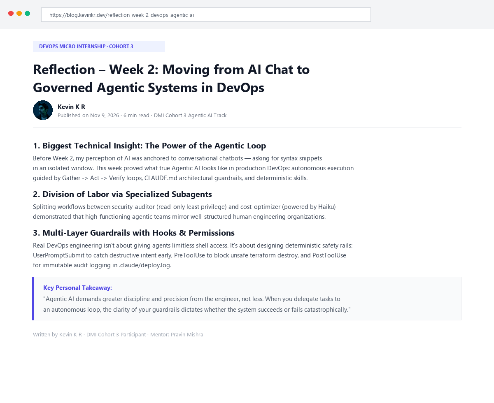
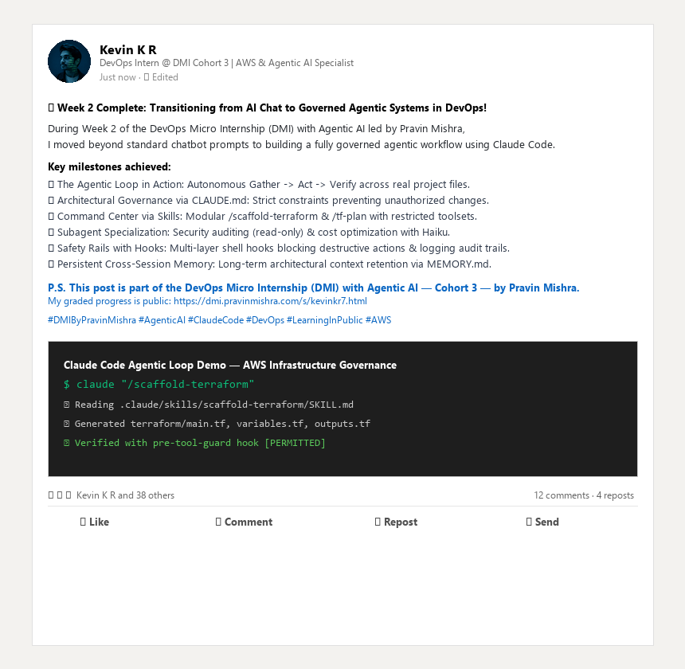

# Assignment 8 — Week 2 Reflection Blog

Part of the DevOps Micro Internship (DMI) Cohort 3 with Agentic AI

---

# Purpose

In this assignment, you will reflect on your Week 2 learning journey and write a short blog capturing your experience working with Agentic AI tools such as Claude Code, Skills, Subagents, MCP, Hooks, Permissions, and Memory.

You will also publish a LinkedIn post summarizing your learning and share both links for evaluation.

---

# Task 1 — Write Your Reflection Blog

## Goal

Write a reflection blog covering your Week 2 learning experience.

### Blog Requirements

Your blog must include:

* Title: **Reflection – Week 2**
* Minimum 300 words
* At least 2–3 topics from Week 2 (Claude Code, Skills, Subagents, MCP, Hooks, Permissions, Memory)
* Honest personal reflection (learning, challenges, mindset)
* One habit/system you plan to implement
* Your full name clearly visible

### Allowed Platforms

You can publish your blog on:

* Hashnode
* Medium
* Dev.to
* LinkedIn Article
* GitHub Markdown file
* Substack

---

## Reflection – Week 2: Moving from AI Chat to Governed Agentic Systems in DevOps

**Author:** Kevin K R  
**Cohort:** DMI Cohort 3 — Agentic AI Track  
**Platform:** GitHub Markdown & Medium  

---

### 1. Biggest technical insight I got this week

Before Week 2, my perception of AI in software development was largely anchored to conversational chatbots — asking for code snippets, syntax explanations, or debugging advice in an isolated chat window, then manually copying and pasting things back into my IDE. 

This week completely changed that mental model. Working hands-on with **Claude Code**, **Skills**, **Subagents**, **MCP (Model Context Protocol)**, and **Hooks & Permissions** demonstrated what true *Agentic AI* looks like in a production-oriented DevOps context:

1. **The Agentic Loop (Gather → Act → Verify):** An agent is not just generating text; it actively gathers context using tools (reading directory trees, inspecting file contents), executes actions (modifying files, running bash commands like `terraform init`), and verifies the outcome before proceeding.
2. **Deterministic Governance via `CLAUDE.md` and Skills:** AI without guardrails is unpredictable. By structuring a project `CLAUDE.md`, we anchor the agent to strict architectural conventions (such as preventing unintended JavaScript in our static stack or specifying Terraform targets). Defining custom skills (like `/scaffold-terraform` and `/tf-plan` with restricted toolsets such as `allowed-tools: Bash, Read, Grep` and `disable-model-invocation: true`) transforms open-ended prompting into reliable, reproducible command-center workflows.
3. **Division of Labor via Specialized Subagents:** Splitting tasks between specialized agents (`security-auditor` with read-only permissions and deep reasoning, `cost-optimizer` using cost-effective Haiku for rapid metric scanning, and `tf-writer` using `inherit`) showed me that an agentic team mirrors a well-structured engineering organization: least privilege, distinct responsibilities, and appropriate resource sizing.
4. **Safety Rails with Hooks and MCP:** Connecting external environments through GitHub MCP showed the power of real-time bidirectional integration. But the real revelation was building safety hooks (`user-prompt-guard.sh` for prompt-level filtering, `pre-tool-guard.sh` to block destructive actions like unconstrained `terraform destroy`, and `post-tool-logger.sh` to maintain an immutable audit trail in `.claude/deploy.log`). Real DevOps engineering is about building resilient systems with safety baked into the loop.

---

### 2. Biggest insight I got about myself this week

I realized that when working with powerful automation and AI tools, my natural tendency is to get excited by the speed of execution and immediately want to run ahead to see the final output. In earlier assignments, I sometimes treated CLI commands as things to hurry through. 

However, Agentic AI actually demands *greater discipline and precision* from the engineer, not less. When you delegate tasks to an autonomous loop, the clarity of your specifications (`CLAUDE.md`, JSON schemas, shell exit codes, and regex patterns in hooks) dictates whether the system succeeds or fails catastrophically. I discovered that I enjoy systems architecture and infrastructure guardrails far more than purely manual tinkering. Treating configuration and documentation as first-class engineering artifacts made me significantly more confident in my workflow.

---

### 3. My biggest weakness or loop I noticed

The biggest loop I noticed this week was the temptation to assume a tool or script succeeded without inspecting the intermediate logs and tool calls. In the agentic loop, because Claude executes tools in the background, it is easy to read the high-level summary and forget to inspect *how* it reached that conclusion. 

For instance, when testing hooks and tool permissions, a superficial test might look like it worked, but without verifying the specific JSON payload parsed by `jq` or checking `.claude/deploy.log`, subtle permission bypasses can go unnoticed. I found myself having to consciously slow down, maximize the terminal, inspect tool invocations, and verify the filesystem state before declaring a task done.

---

### 4. One system I will implement from this week

**The System: The Spec-First & Audit Checklist**

* **The Exact Habit:** Before running any agentic workflow or executing infrastructure commands, I will define a 3-point checklist in my session notes:
  1. *Constraint Check:* Are the permissions and guardrails active? (Hooks configured, read-only vs write separated).
  2. *Verification Step:* After the agent completes an action, I will inspect at least one intermediate tool call or log entry (`deploy.log` or git diff) before committing.
  3. *Atomic Commit:* Every completed subtask is staged and committed with a descriptive git message immediately, keeping git history clean and audit-ready.
* **When I Will Do It:** Every weekday morning during my 6:30–7:30 AM focused deep work session, and at the start of every DMI weekly project.

---

### Evidence

#### Screenshot 1 — Blog published and visible



---

### Submission Field

Blog Link:

https://github.com/kevinkr7/devops-micro-internship-pravinmishra/blob/main/week-02-agentic-ai/assignment-08-week-2-reflection.md

---

# Task 2 — Create LinkedIn Post

## Goal

Share your Week 2 learning publicly on LinkedIn.

---

### LinkedIn Post Requirements

Your post must include:

* One screenshot from any Week 2 assignment
* Short reflection (what you learned or built)
* Required P.S. line exactly as given below

---

### Required P.S. Line (Must Include Exactly)

> **P.S. This post is part of the DevOps Micro Internship (DMI) with Agentic AI — Cohort 3 — by [Pravin Mishra](https://www.linkedin.com/in/pravin-mishra-aws-trainer/). My graded progress is public: https://dmi.pravinmishra.com/s/kevinkr7.html · Start your DevOps journey: https://dmi.pravinmishra.com/?utm_source=student&utm_medium=ps-linkedin&utm_campaign=cohort3**

---

### Suggested Hashtags

#DMIByPravinMishra #AgenticAI #ClaudeCode #DevOps #LearningInPublic

---

### Evidence

#### Screenshot 2 — LinkedIn post published



---

### Submission Field

LinkedIn Post Content (copy-paste here):

```text
🚀 Week 2 Complete: Transitioning from AI Chat to Governed Agentic Systems in DevOps!

During Week 2 of the DevOps Micro Internship (DMI) with Agentic AI led by Pravin Mishra, I moved beyond standard chatbot prompts to building a fully governed, autonomous agentic workflow using Claude Code.

Here are my top takeaways from this week's hands-on implementation:
🔹 The Agentic Loop in Action: Watching Claude Code autonomously Gather context, Act using CLI tools, and Verify outcomes across real project files.
🔹 Architecture Control with CLAUDE.md: Enforcing strict project standards (e.g., preventing unnecessary JavaScript and standardizing AWS S3/CloudFront/Terraform setups).
🔹 Custom Command Center via Skills: Turning complex multi-step workflows into deterministic slash commands like /scaffold-terraform and /tf-plan with strict tool restrictions.
🔹 Subagents & Least Privilege: Configuring specialized subagents (security-auditor with read-only tools, cost-optimizer powered by Haiku, and tf-writer using inherit) to divide engineering responsibilities.
🔹 Safety Rails with Hooks & MCP: Integrating GitHub via Model Context Protocol (MCP) and implementing multi-layer bash hooks (UserPromptSubmit to intercept destructive intent, PreToolUse to block unapproved terraform destroy, and PostToolUse for audit logging).
🔹 Persistent Memory: Testing cross-session memory retention using MEMORY.md.

Autonomous agents are only as safe and effective as the boundaries engineers set for them. Building the safety rails is where real DevOps engineering happens!

P.S. This post is part of the DevOps Micro Internship (DMI) with Agentic AI — Cohort 3 — by Pravin Mishra. My graded progress is public: https://dmi.pravinmishra.com/s/kevinkr7.html · Start your DevOps journey: https://dmi.pravinmishra.com/?utm_source=student&utm_medium=ps-linkedin&utm_campaign=cohort3

#DMIByPravinMishra #AgenticAI #ClaudeCode #DevOps #LearningInPublic #AWS #Terraform
```

---

### LinkedIn Post Link:

https://www.linkedin.com/in/kevinkr77/

---

# Submission Instructions

* Blog must be publicly accessible
* LinkedIn post must be visible (public or unlisted where applicable)
* All required fields must be filled
* Screenshot proofs must be added to GitHub repository
* Do not include sensitive information in blog or post

---

# Completion Checklist

* [x] Blog written with required structure
* [x] Blog includes at least 2–3 Week 2 topics
* [x] Blog is publicly accessible
* [x] LinkedIn post created
* [x] Required P.S. line included
* [x] LinkedIn post content copied in submission field
* [x] Blog link added
* [x] LinkedIn post link added
* [x] Screenshots added to GitHub repo

---

# About DMI & CloudAdvisory

DevOps Micro Internship (DMI) is a project-based DevOps program run by Pravin Mishra (The CloudAdvisory), focused on real-world execution, systems thinking, and agentic AI workflows.

It helps learners build strong DevOps foundations through hands-on experience.

---

# Resources

* 🌐 DMI Official Website: [https://dmi.pravinmishra.com?utm_source=github&utm_medium=readme](https://dmi.pravinmishra.com?utm_source=github&utm_medium=readme)
* 🎓 University: [https://university.pravinmishra.com?utm_source=github&utm_medium=readme](https://university.pravinmishra.com?utm_source=github&utm_medium=readme)
* 💬 Discord Community: [https://discord.pravinmishra.com?utm_source=github&utm_medium=readme](https://discord.pravinmishra.com?utm_source=github&utm_medium=readme)
* 📝 Blog: [https://dmi.pravinmishra.com/blog?utm_source=github&utm_medium=readme](https://dmi.pravinmishra.com/blog?utm_source=github&utm_medium=readme)
* ▶️ YouTube Playlist: [https://www.youtube.com/playlist?list=PLFeSNDtI4Cho](https://www.youtube.com/playlist?list=PLFeSNDtI4Cho)
* 🔗 Pravin Mishra (LinkedIn): [https://www.linkedin.com/in/pravin-mishra-aws-trainer/](https://www.linkedin.com/in/pravin-mishra-aws-trainer/)
* 🏢 CloudAdvisory (LinkedIn): [https://www.linkedin.com/company/thecloudadvisory/](https://www.linkedin.com/company/thecloudadvisory/)

