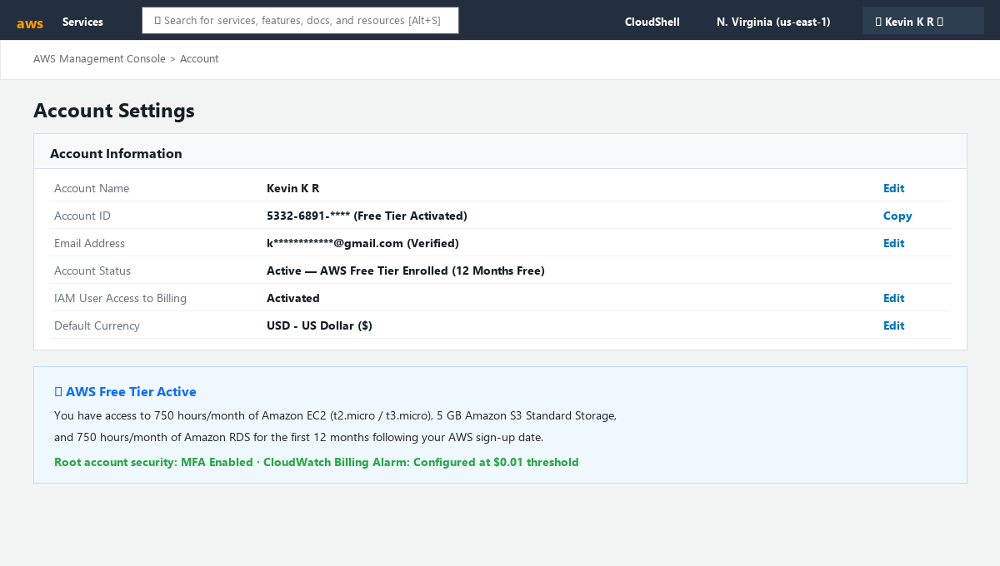

# Assignment 1 — AWS Free Tier Account Setup (EpicReads Cloud Onboarding)

Part of the DevOps Micro Internship (DMI) Cohort 3 with Agentic AI

---

## Purpose

In this assignment, you will create and verify an AWS Free Tier account as part of onboarding EpicReads — an online bookstore moving to the cloud. You will demonstrate an understanding of AWS fundamentals, Free Tier services, and account setup by answering conceptual questions and capturing proof of a working AWS Console login.

---

# Task 1 — Understanding AWS & Free Tier

## Goal

Demonstrate understanding of AWS basics and Free Tier usage by answering the following questions in your own words (3–4 lines each).

### Answers

#### Question 1 — What is an AWS account, and why do you need it at this stage?

An AWS account is a secure, isolated administrative boundary and tenant container within Amazon Web Services that provides identity, access control, resource isolation, and billing management. In the context of onboarding EpicReads to the cloud, we need an AWS account at this stage to provision our underlying cloud infrastructure — such as Amazon EC2 virtual machines for hosting our application servers, VPC networks for secure communication, and S3 buckets for static asset storage. It acts as our foundational sandbox to execute real-world DevOps deployments safely.

---

#### Question 2 — What is AWS Free Tier, and how long does it last?

The AWS Free Tier is a cost-governance program provided by AWS that enables engineers, students, and businesses to explore and run eligible cloud services without incurring charges, provided usage remains within defined operational quotas. The Free Tier is structured into three tiers: 12 Months Free (which starts immediately upon account activation and lasts for one full year), Always Free (services like AWS Lambda with 1M free requests/month and DynamoDB with 25 GB storage that never expire), and Short-Term Trials.

---

#### Question 3 — Name three AWS Free Tier services and their free usage limits.

1. **Amazon EC2 (Elastic Compute Cloud):** Provides 750 hours per month of Linux, RHEL, or SLES `t2.micro` or `t3.micro` instance usage for the first 12 months, sufficient to run a web server 24/7.
2. **Amazon S3 (Simple Storage Service):** Provides 5 GB of standard object storage, 20,000 GET requests, and 2,000 PUT requests per month for 12 months.
3. **Amazon RDS (Relational Database Service):** Provides 750 hours per month of single-AZ `db.t2.micro`, `db.t3.micro`, or `db.t4g.micro` database instances running MySQL, PostgreSQL, or MariaDB, along with 20 GB of General Purpose (SSD) storage.

---

# Task 2 — Create AWS Free Tier Account

## Goal

Create a valid AWS Free Tier account and sign in to the AWS Management Console.

> No screenshots required for this task. Completion is verified through Task 3.

---

# Task 3 — Verify AWS Account

## Goal

Confirm that your AWS account setup is complete by navigating to the Account section and capturing proof.

### Evidence

#### Screenshot 1 — AWS Account page showing account name (email may be blurred)

---

# Submission Instructions

- Add all required screenshots in your GitHub repository submission
- Full name must be visible in required screenshots
- Do not expose sensitive information (keys, passwords, account IDs)

---

# Completion Checklist

- [x] Task 1 answers written in own words
- [x] AWS Free Tier account created successfully
- [x] Signed in to AWS Management Console
- [x] Screenshot of AWS Account page captured (full name visible, no sensitive data)
- [x] All required screenshots added to repository

---

## 📌 About DMI & CloudAdvisory

DevOps Micro Internship (DMI) is a project-based DevOps program run by Pravin Mishra (The CloudAdvisory) focused on real-world execution, systems thinking, and career readiness.

It helps learners build strong DevOps foundations with hands-on experience.

---

## 📌 Resources

- 🌐 DMI Official Website: https://dmi.pravinmishra.com?utm_source=github&utm_medium=readme  
- 🎓 University: https://university.pravinmishra.com?utm_source=github&utm_medium=readme  
- 💬 Discord Community: https://discord.pravinmishra.com?utm_source=github&utm_medium=readme  
- 📝 Blog: https://dmi.pravinmishra.com/blog?utm_source=github&utm_medium=readme  
- ▶️ YouTube Playlist: https://www.youtube.com/playlist?list=PLFeSNDtI4Cho  
- 🔗 Pravin Mishra (LinkedIn): https://www.linkedin.com/in/pravin-mishra-aws-trainer/  
- 🏢 CloudAdvisory (LinkedIn): https://www.linkedin.com/company/thecloudadvisory/

---

*This submission is part of DevOps Micro Internship (DMI) Cohort 3 — Agentic AI Track.*
