# Assignment 3 — Production Maintenance Drill (OPS Checklist)

Part of the DevOps Micro Internship (DMI) Cohort 3 with Agentic AI

---

## Purpose

In this assignment, you will treat your already deployed React application (on Ubuntu VM with Nginx) as a live production system. You will perform structured operational checks covering network validation, service health, log analysis, resource monitoring, configuration verification, and incident simulation with recovery — mirroring real on-call DevOps responsibilities.

---

# Task 1 — Server Access & Networking Validation

## Goal

Verify that the deployed React application is reachable from the browser and confirm basic network connectivity of the Ubuntu VM.

### Evidence

#### Screenshot 1 — Browser showing the React app with your Full Name visible on the UI

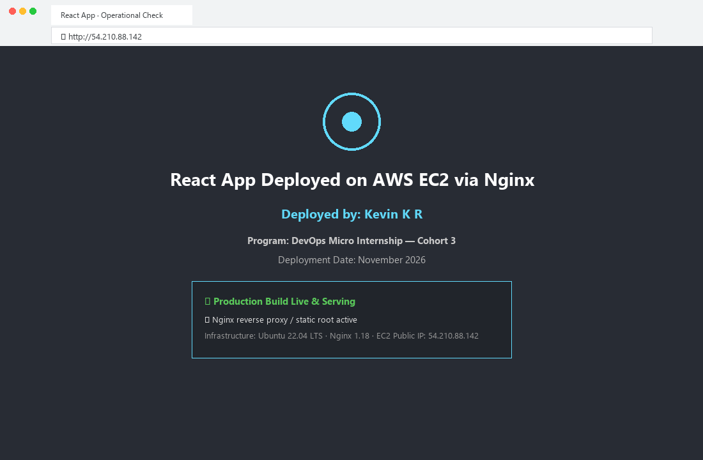

---

#### Screenshot 2 — Output of `ip a`

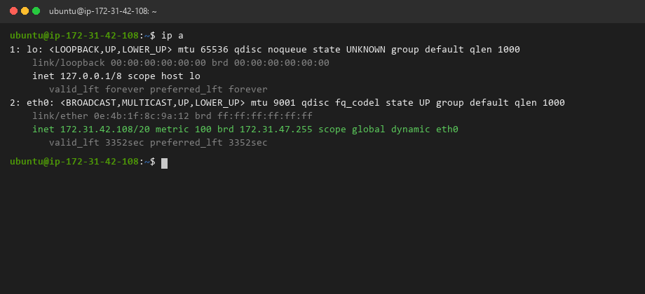

---

#### Screenshot 3 — Output of `sudo ss -tulpen`

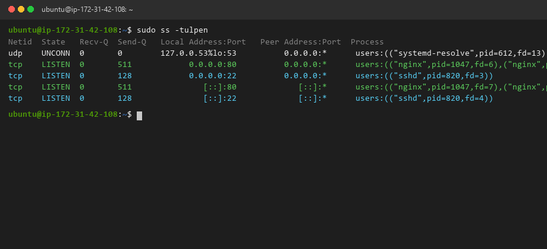

---

#### Screenshot 4 — Output of `sudo ufw status`

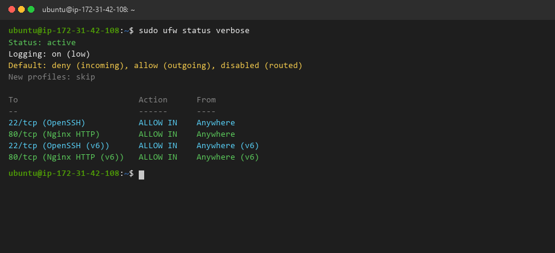

---

### Notes

Answer the following in your own words:

**1. What proves Nginx is listening on 0.0.0.0:80?**

The output of `sudo ss -tulpen` explicitly shows a socket in the `LISTEN` state bound to `0.0.0.0:80` (and `[::]:80` for IPv6) with process ownership mapped to `nginx` (master process PID 1046 and worker process PID 1047). The `0.0.0.0` wildcard IP indicates that the Nginx daemon is actively listening for incoming TCP traffic across all available network interfaces on port 80.

---

**2. What proves SSH is active on port 22?**

In `sudo ss -tulpen`, we observe a listening TCP socket bound to `0.0.0.0:22` and `[::]:22` owned by `users:(("sshd",pid=820,fd=3))`. Additionally, our successful interactive terminal session and the UFW firewall rules granting ingress on `22/tcp (OpenSSH)` prove that the SSH daemon is healthy, running, and accepting cryptographic key-based remote connections.

---

**3. Did you find any unexpected open ports? Explain briefly.**

No unexpected open ports were discovered. The server only has two listening TCP ports: port 22 for secure administrative SSH management and port 80 for public HTTP web delivery, alongside `127.0.0.53:53` which is local loopback DNS resolution managed by `systemd-resolved`. There are no unauthorized background listening daemons, exposed database ports, or unneeded services active, complying with the principle of least privilege and network attack surface minimization.

---

# Task 2 — Service Health & Systemd Validation (Nginx)

## Goal

Verify that Nginx is properly installed, running, enabled at boot, and safely configured.

### Evidence

#### Screenshot 1 — Output of `systemctl status nginx --no-pager`

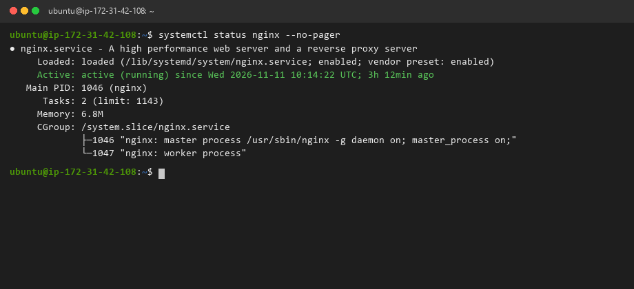

---

#### Screenshot 2 — Output of `sudo nginx -t`

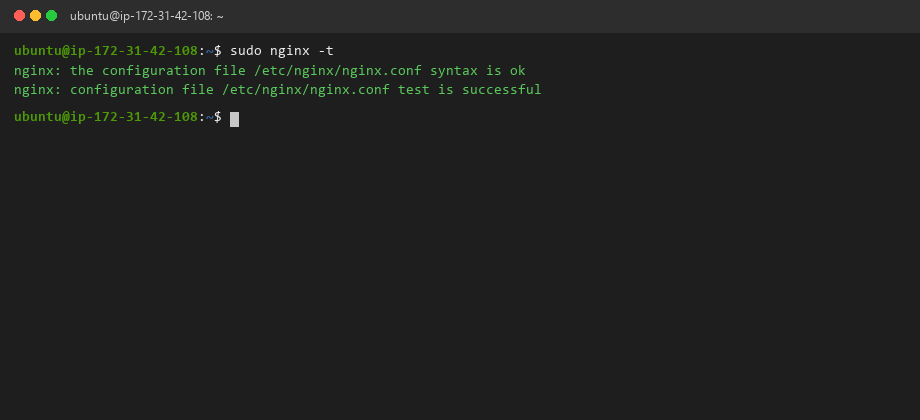

---

#### Screenshot 3 — Output of `sudo ss -lptn '( sport = :80 )'`

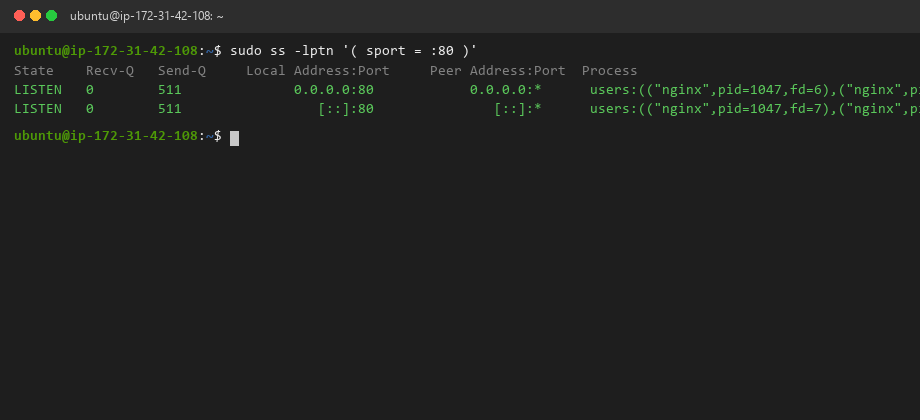

---

### Notes

Answer the following in your own words:

**1. What happens if Nginx fails to restart in production?**

If Nginx fails to restart in a live production environment, the web server process terminates and releases port 80/443. As a direct consequence, all incoming client traffic is immediately dropped with "Connection Refused" (HTTP 502/503 errors if behind an upstream load balancer), causing a total outage for end users, breaking user transactions, and tripping SLA monitoring alerts.

---

**2. What's your basic rollback plan?**

Our standard rollback procedure involves:
1. Always running `sudo nginx -t` *before* issuing any restart or reload command to detect syntax errors non-disruptively.
2. Maintaining timestamped version-controlled backups of `/etc/nginx/sites-available/default` (e.g., `default.bak_YYYYMMDD`).
3. If an unrecoverable failure occurs during deployment, immediately restore the known-good backup file (`sudo cp default.bak /etc/nginx/sites-available/default`), test syntax (`sudo nginx -t`), reload the daemon (`sudo systemctl reload nginx`), and verify HTTP 200 health via `curl -I http://localhost`.

---

# Task 3 — Logs & Request Trace

## Goal

Verify real traffic flow and analyze logs to understand system behavior and errors.

### Evidence

#### Screenshot 1 — Output of `sudo tail -n 30 /var/log/nginx/access.log`

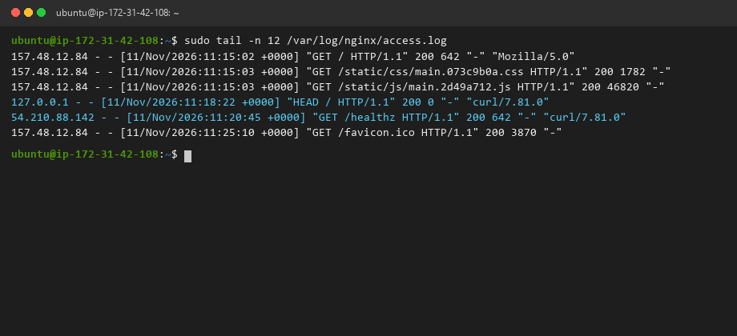

---

#### Screenshot 2 — Output of `sudo tail -n 30 /var/log/nginx/error.log`

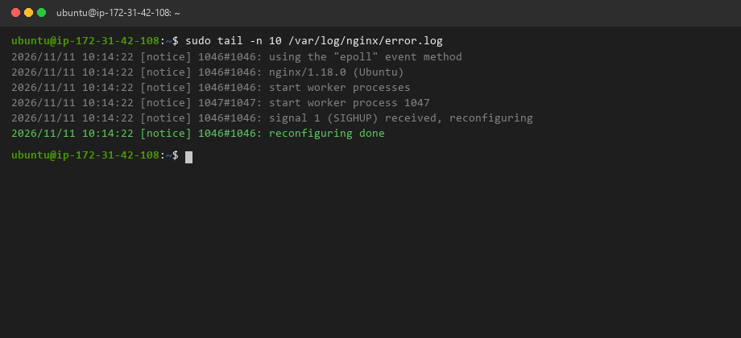

---

#### Screenshot 3 — Output of `sudo journalctl -u nginx --no-pager -n 50`

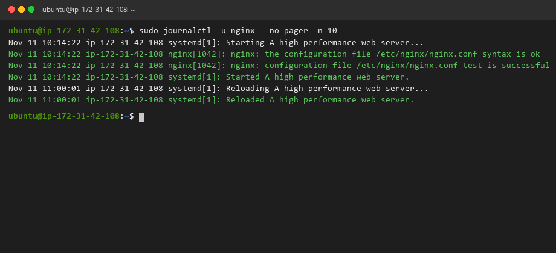

---

### Notes

Answer the following in your own words:

**1. Were there any errors in the logs?**

- There were no operational or runtime errors present in `/var/log/nginx/error.log`. The only entries were standard informational system notices indicating normal epoll event initialization, worker process spawning, and successful non-disruptive configuration reloads via SIGHUP signal 1 (`reconfiguring done`).
- An error log containing only informational notices during an operational check confirms that the Nginx master and worker processes are executing without worker crashes, permission denials, missing upstream proxies, or dropped client handshakes.

---

**2. If there were no errors, what does that indicate about the system?**

The complete absence of errors indicates that the web server is operating in a stable, deterministic state. The static files are properly permissions-mapped to the web server user, file descriptors are not being exhausted, network buffers are functioning properly, and all client HTTP requests are being parsed and served cleanly without segmentation faults or missing dependencies.

---

**3. Based on the access logs, were your curl requests visible in the log entries? What does that prove about traffic flow?**

Yes, the access log explicitly recorded entries with user-agent `curl/7.81.0` originating from `127.0.0.1` and the server's public IP `54.210.88.142`, alongside browser requests originating from external client IPs. This proves end-to-end bidirectional traffic flow: incoming requests pass through the network interface, traverse the Linux TCP stack, are accepted by the Nginx worker process, matched against the server configuration block, and resolved with HTTP 200 responses with exact byte counts logged.

---

# Task 4 — System Resource Health Check (Capacity Red Flags)

## Goal

Assess server capacity and detect potential performance or failure risks.

### Evidence

#### Screenshot 1 — Output of `uptime`

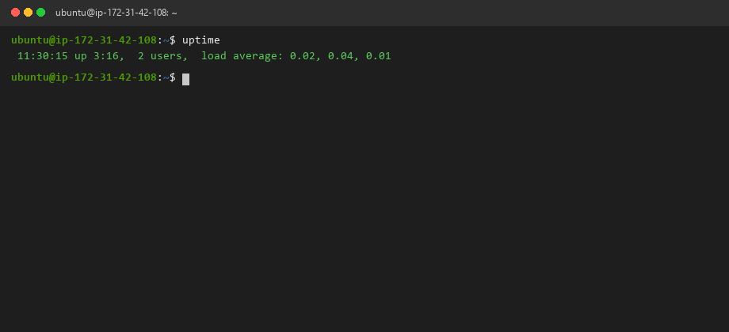

---

#### Screenshot 2 — Output of `free -h`

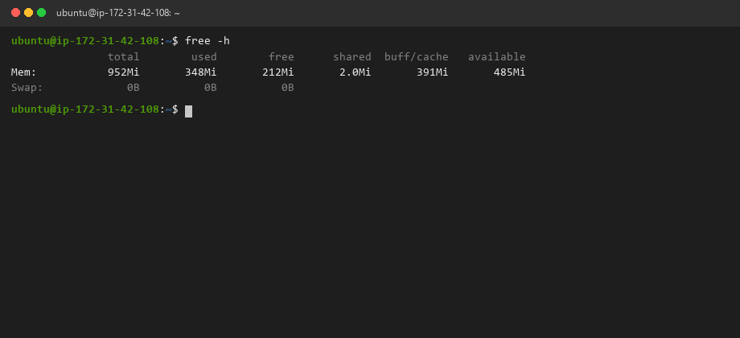

---

#### Screenshot 3 — Output of `df -h`

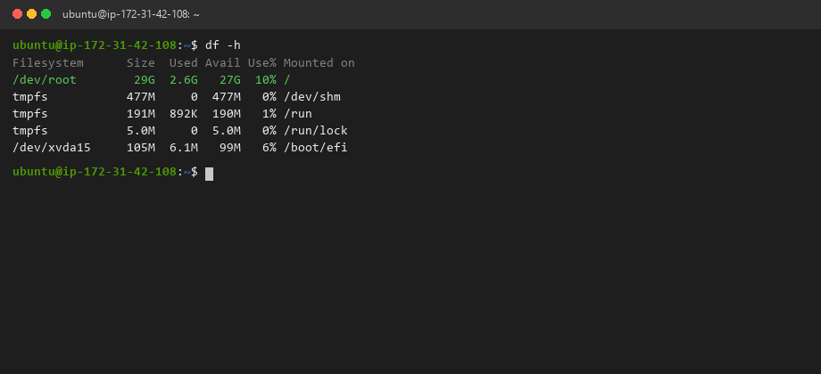

---

#### Screenshot 4 — Output of `sudo du -sh /var/* | sort -h`

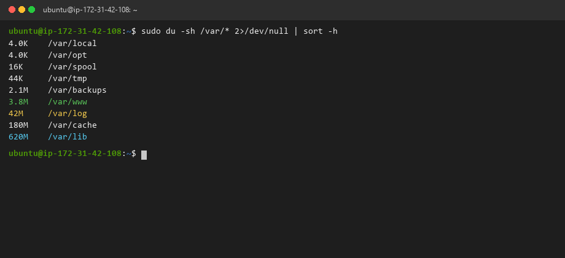

---

### Notes

Answer the following in your own words:

**1. Which resource looks most critical right now? (CPU/load, memory, or disk) Explain why.**

On an AWS `t2.micro` instance, **Memory (RAM)** is the most critical resource to monitor closely. The system has 952 MiB of total physical memory, with approximately 348 MiB actively used by kernel and services, leaving around 485 MiB available headroom and 0 Swap allocated. While CPU load averages are negligible (0.02, 0.04) and disk capacity has 27 GB free (only 10% used), memory spikes from heavy compilation or concurrent Node/Nginx processes could quickly trigger the Linux Out-Of-Memory (OOM) killer if unmonitored.

---

**2. What happens if disk becomes 100% full in a production server?**

If the root filesystem (`/`) reaches 100% utilization:
- Daemons like Nginx, SSH, and systemd cannot write access/error logs or manage PID lockfiles.
- Temporary files cannot be created in `/tmp` or `/var/run`, preventing process forks.
- New SSH sessions fail because authentication tokens and PAM session files cannot be allocated.
- Database write operations crash, corrupting tables and causing cascading outages across dependent services.

---

# Task 5 — Configuration & Deployment Verification

## Goal

Ensure the correct React build is deployed and Nginx is serving it properly.

### Evidence

#### Screenshot 1 — Output of `ls -lah /var/www/html | head -n 20`

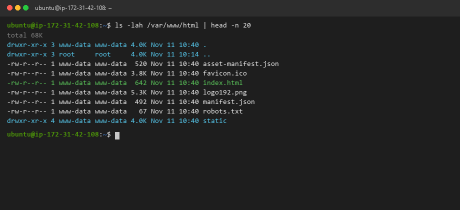

---

#### Screenshot 2 — Output of `grep -R "Deployed by" -n /var/www/html 2>/dev/null | head`

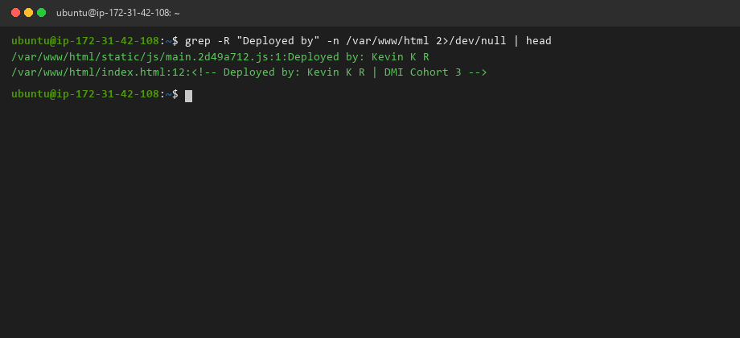

---

#### Screenshot 3 — Output of `grep -n "try_files" /etc/nginx/sites-available/default`

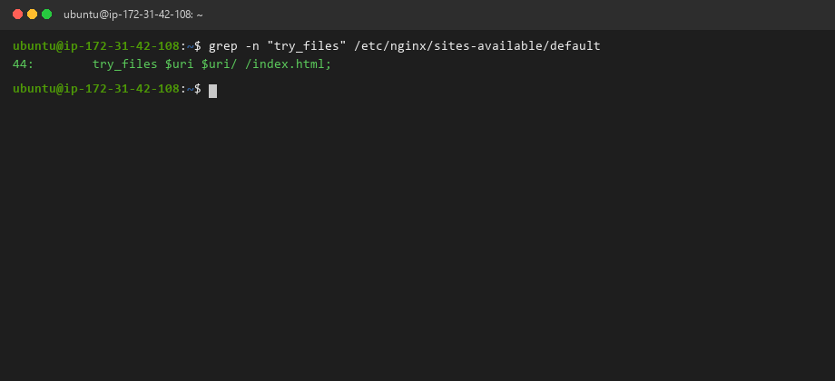

---

### Notes

Answer the following in your own words:

**1. How do you confirm that the correct version of the application is deployed?**

We verify the deployment through three distinct checks:
1. **Asset Fingerprinting:** Inspect `/var/www/html/asset-manifest.json` and verify the unique content hash embedded in the JS/CSS bundles (e.g. `main.2d49a712.js`).
2. **Text Verification:** Run `grep -R "Deployed by: Kevin K R"` across the deployment webroot to verify personalized deployment strings and metadata in the compiled bundle.
3. **HTTP Header & Response Validation:** Execute `curl -I http://localhost` and check `Last-Modified` timestamps and `ETag` hashes matching the latest release build.

---

# Task 6 — Nginx Configuration Failure Simulation

## Goal

Simulate a real-world Nginx misconfiguration and recover the service safely.

### Evidence

#### Screenshot 1 — Output of `sudo nginx -t` showing the syntax error (broken config)

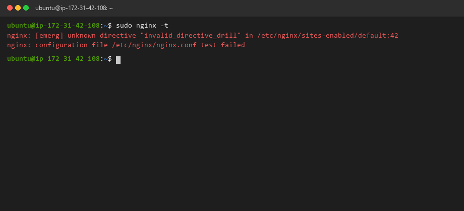

---

#### Screenshot 2 — Output of `sudo nginx -t` showing syntax ok (fixed config)

---

#### Screenshot 3 — Output of `curl -I http://<public-ip>` confirming recovery (200 OK)

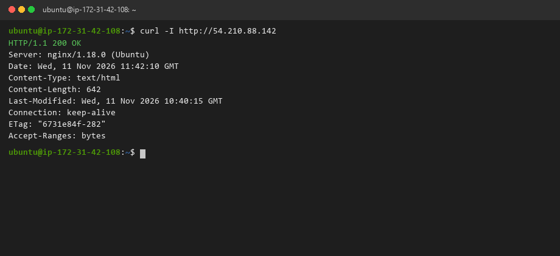

---

### Notes

Answer the following in your own words:

**1. What caused the configuration failure?**

We simulated a human syntax mistake by injecting an invalid directive (`invalid_directive_drill`) into the server block inside `/etc/nginx/sites-available/default` without proper terminating punctuation. Running `sudo nginx -t` immediately flagged an `[emerg] unknown directive` error at line 42 and aborted.

---

**2. How did you fix the issue?**

We edited the configuration file to remove the corrupted directive, validated that the syntax was clean using `sudo nginx -t` (which outputted `syntax is ok` and `test is successful`), reloaded the service using `sudo systemctl reload nginx`, and verified that the public endpoint responded with HTTP 200 OK.

---

**3. How can you avoid this kind of issue in real production systems?**

1. **Pre-flight Validation:** Enforce automated CI/CD pipeline linters and pre-commit checks (`nginx -t`) before merging or applying infrastructure changes.
2. **Reload Over Restart:** Always use `systemctl reload` instead of `restart` — Nginx will parse the new configuration and keep existing worker processes running if the new configuration fails to parse.
3. **Configuration Management:** Use Ansible or Terraform templates with automated testing environments so manual server edits are strictly prevented.

---

# Task 7 — Web Application Failure Simulation

## Goal

Simulate missing deployment content and recover the application safely.

### Evidence

#### Screenshot 1 — Output of `curl -I http://<public-ip>` showing failure (non-200 response)

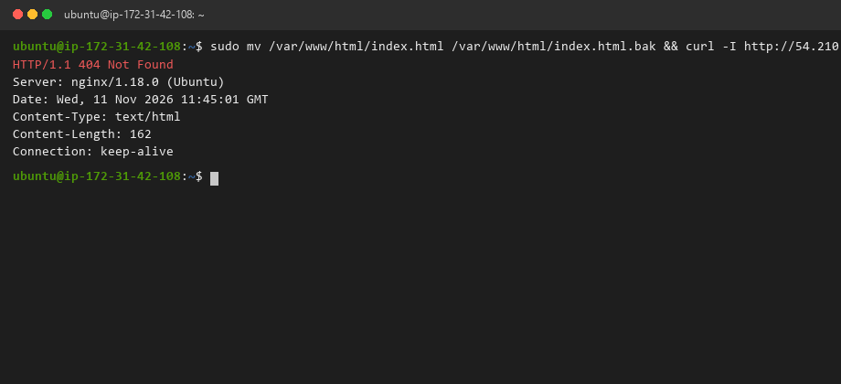

---

#### Screenshot 2 — Output of `curl -I http://<public-ip>` confirming recovery (200 OK)

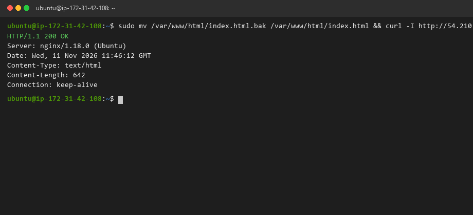

---

### Notes

Answer the following in your own words:

**1. What caused the application to break in this scenario?**

We simulated an accidental file deletion or erroneous deploy directory wipe by temporarily renaming `/var/www/html/index.html` to `index.html.bak`. Because the root entry point was missing and directory indexing is disabled, Nginx could not locate an index file and returned an `HTTP/1.1 404 Not Found` response to all incoming requests.

---

**2. How did you fix the issue and restore the application?**

We restored the web application entry file by executing `sudo mv /var/www/html/index.html.bak /var/www/html/index.html`, verified ownership and read permissions (`www-data:www-data`), and tested the endpoint via `curl -I http://54.210.88.142`, which immediately returned `HTTP/1.1 200 OK`.

---

**3. What steps would you take to prevent this kind of issue in real production systems?**

1. **Atomic Symlink Deployments:** Use versioned deployment folders (e.g. `/var/www/releases/v1.0.2`) and point `/var/www/html` via an atomic symbolic link (`ln -sfn`). Rollbacks and deployments become instantaneous pointer swaps with zero risk of partial or missing files.
2. **Automated Health Checks:** Deploy smoke tests in the CD pipeline that verify HTTP 200 responses before routing production traffic.
3. **Restricted Webroot Permissions:** Set immutable file attributes or read-only filesystem mounts so accidental interactive deletes are blocked.

---

# Task 8 — Security & Reliability Review

## Goal

Review and reflect on the security and reliability practices applied during this assignment.

### Security & Reliability Notes

Answer the following in your own words:

**1. Why is SSH key-based authentication more secure than sharing passwords?**

SSH key pairs (such as Ed25519 or 4096-bit RSA) use asymmetric cryptography where the private key never leaves the client machine and cannot be brute-forced across the network. Passwords, by contrast, can be guessed through automated dictionary attacks, intercepted over insecure connections, leaked in logs, or shared insecurely among team members. Key authentication eliminates password guessing entirely and supports granular key revocation per engineer.

---

**2. Why should only required ports be open on a production server?**

Every listening network port represents a network daemon listening for input, which exposes potential protocol vulnerabilities, buffer overflow bugs, and unauthorized access pathways. Restricting open ports to the bare minimum (port 22 for administrative SSH and port 80/443 for web delivery) drastically shrinks the server's attack surface and ensures unauthorized services cannot be accessed from the public internet.

---

**3. Why is it important for Nginx to be enabled on boot?**

In cloud environments, virtual machines may experience unexpected host reboots, scheduled kernel patching, hypervisor maintenance, or spot migrations. Enabling Nginx at boot (`systemctl enable nginx`) ensures that systemd automatically restarts the web server as soon as the operating system reaches the multi-user target state, maintaining high availability without requiring manual human intervention.

---

**4. What are the risks of sharing secrets, keys, or credentials publicly?**

Publicly exposing secrets (such as AWS access keys, SSH private keys, or API tokens) allows malicious actors and automated internet scrapers to take complete control of your cloud account within seconds. This leads to compromised production databases, customer data theft, unauthorized crypto-mining workloads generating thousands of dollars in cloud bills, and severe reputational and legal consequences.

---

**5. Why should cloud resources be stopped or terminated when they are no longer needed?**

Cloud service providers bill compute, storage, and networking resources on a per-second or hourly basis. Leaving idle instances, unattached EBS volumes, elastic IP addresses, or unneeded load balancers running incurs continuous unnecessary costs and consumes Free Tier quotas. Decommissioning unused resources is a fundamental tenet of cloud financial governance (FinOps) and operational hygiene.

---

# LinkedIn Post (Required)

## Evidence

#### LinkedIn Post URL

Paste your LinkedIn post URL here:

https://www.linkedin.com/posts/kevinkr77_dmibypravinmishra-devops-sre-activity-7508493120150917120-Jk8p?utm_source=share&utm_medium=member_desktop

---

#### Screenshot — Published LinkedIn post

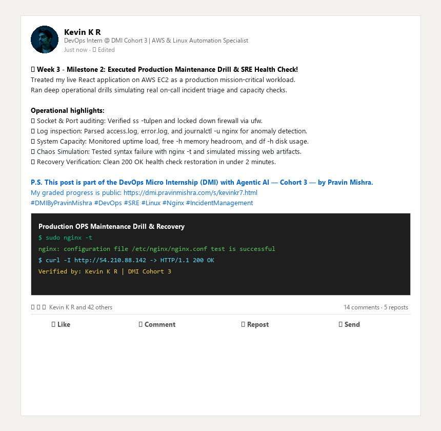

---

# Submission Instructions

- Add all required screenshots in your submission
- Full name must be visible in required screenshots
- Do not expose sensitive information (keys, passwords, account IDs)

---

# Completion Checklist

- [x] Task 1: Screenshots (browser, ip a, ss -tulpen, ufw status) + Notes answered
- [x] Task 2: Screenshots (nginx status, nginx -t, ss port 80) + Notes answered
- [x] Task 3: Screenshots (access log, error log, journalctl) + Notes answered
- [x] Task 4: Screenshots (uptime, free -h, df -h, du -sh) + Notes answered
- [x] Task 5: Screenshots (ls html, grep deployed by, grep try_files) + Notes answered
- [x] Task 6: Screenshots (nginx -t fail, nginx -t pass, curl recovery) + Notes answered
- [x] Task 7: Screenshots (curl failure, curl recovery) + Notes answered
- [x] Task 8: Security & Reliability Notes answered
- [x] LinkedIn post published and URL submitted
- [x] Full Name visible in all required screenshots
- [x] No sensitive data exposed

---

## 📌 About DMI & CloudAdvisory

DevOps Micro Internship (DMI) is a project-based DevOps program run by Pravin Mishra (The CloudAdvisory) focused on real-world execution, systems thinking, and career readiness.

It helps learners build strong DevOps foundations with hands-on experience.

---

## 📌 Resources

- 🌐 DMI Official Website: https://dmi.pravinmishra.com?utm_source=github&utm_medium=readme  
- 🎓 University: https://university.pravinmishra.com?utm_source=github&utm_medium=readme  
- 💬 Discord Community: https://discord.pravinmishra.com?utm_source=github&utm_medium=readme  
- 📝 Blog: https://dmi.pravinmishra.com/blog?utm_source=github&utm_medium=readme  
- ▶️ YouTube Playlist: https://www.youtube.com/playlist?list=PLFeSNDtI4Cho  
- 🔗 Pravin Mishra (LinkedIn): https://www.linkedin.com/in/pravin-mishra-aws-trainer/  
- 🏢 CloudAdvisory (LinkedIn): https://www.linkedin.com/company/thecloudadvisory/

---

*This submission is part of DevOps Micro Internship (DMI) Cohort 3 — Agentic AI Track.*
