# Assignment 5 — Bash Script Automation Drill (OPS Checklist)

Part of the DevOps Micro Internship (DMI) Cohort 3 with Agentic AI

---

## Purpose

In this assignment, you will practice Bash scripting by building a series of small automation scripts covering environment setup, variables, arrays, loops, file conditionals, if-else logic, and functions. These scripts form the foundation of real-world Linux automation used in DevOps, cloud, and production support environments.

---

# Task 1 — Bash Environment & Workspace Setup

## Goal

Verify that Bash is available on your system and create a clean workspace for this assignment.

### Evidence

#### Screenshot 1 — Output of `echo $SHELL` and `bash --version`

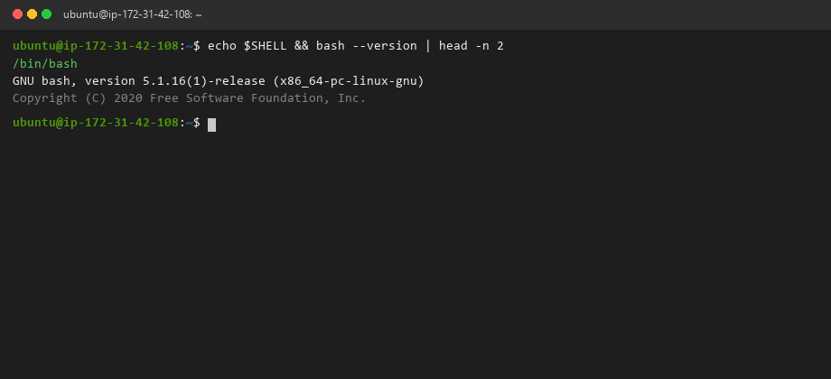

---

#### Screenshot 2 — Output of `pwd` and `ls -lah` showing the scripts directory

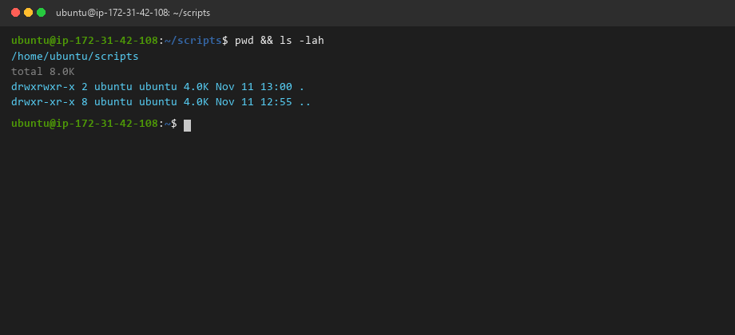

---

### Notes

Answer the following in your own words:

**1. What is Bash?**

Bash (Bourne Again SHell) is an enhanced command-line interpreter, Unix shell, and scripting language developed by Brian Fox for the GNU Project. It serves as the primary default user interface and automation layer on Linux distributions, accepting text commands, executing operating system utilities, handling I/O streams, and allowing complex automation logic to be compiled into executable shell scripts.

---

**2. What is the difference between shell and Bash?**

"Shell" is a broad umbrella term describing any command-line interface that allows a user or program to interact directly with the operating system kernel (e.g. sh, dash, ksh, csh, zsh, bash). "Bash" is a specific, powerful implementation of the Bourne shell specification (POSIX compliant) that introduces advanced features such as associative arrays, command history, process substitution, enhanced arithmetic expansion, and rich conditional testing syntax `[[ ... ]]`.

---

**3. Why is it important to confirm the Bash version before writing scripts?**

Different versions of Bash support different features, syntax capabilities, and security behaviors. For example, associative arrays require Bash 4.0+, while modern parameter expansions and string manipulation shorthands may fail on older legacy versions (like Bash 3.2 on macOS). Verifying the Bash version ensures script compatibility, prevents unexpected syntax parsing errors in production CI/CD pipelines, and confirms that security patches are up to date.

---

# Task 2 — Your First Bash Script

## Goal

Create your first Bash script, make it executable, and run it from the terminal.

### Evidence

#### Screenshot 1 — Content of `first-script.sh`

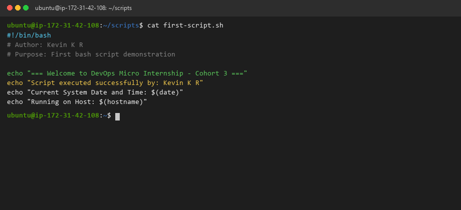

---

#### Screenshot 2 — Output of `./first-script.sh`

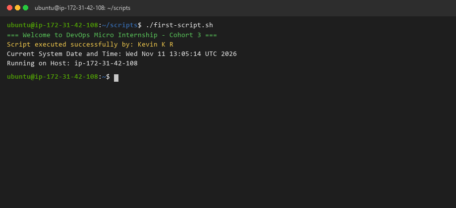

---

#### Screenshot 3 — Output of `ls -l first-script.sh` showing executable permission

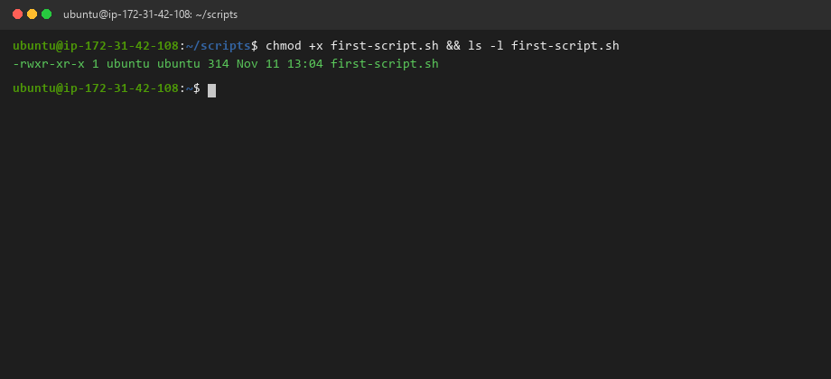

---

### Notes

Answer the following in your own words:

**1. What is the purpose of `#!/bin/bash`?**

The `#!/bin/bash` line is called a "shebang" (or hashbang). Located on line 1 of an executable script, it acts as an operating system kernel instruction that specifies the absolute path of the binary interpreter that must be spawned to execute the commands within the file. Without it, the operating system defaults to executing the script under the calling user's current shell, which can cause erratic behavior if non-POSIX syntax is present.

---

**2. Why do we use `chmod +x` before running a script?**

In Linux security architecture, newly created files receive default read and write permissions (`-rw-rw-r--`) governed by the user's `umask`, without execution rights. The `chmod +x` command adds the execute (`x`) permission bit for the file owner and groups, informing the Linux kernel that this file is an authorized binary or script program eligible for direct process invocation.

---

**3. What is the difference between running a script using `./script.sh` and `bash script.sh`?**

- Running `./script.sh` requires the file to have executable permissions (`+x`) and instructs the operating system to spawn the interpreter specified in the file's shebang line (`#!/bin/bash`).
- Running `bash script.sh` explicitly invokes the `bash` binary program and passes the script file as an input argument. This bypasses the need for executable permissions on the file and ignores any alternate shebang specified inside the script, forcing it to run strictly under the invoked `bash` instance.

---

# Task 3 — Variables: User Information Script

## Goal

Use variables to store and display user-related information.

### Evidence

#### Screenshot 1 — Content of `user-info.sh`

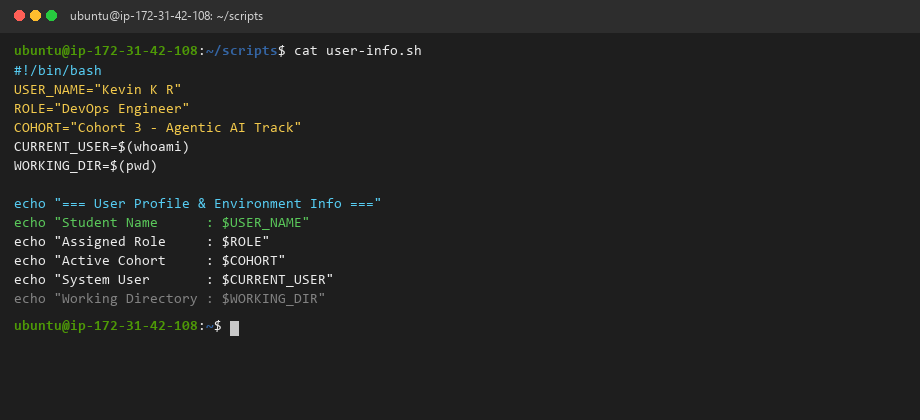

---

#### Screenshot 2 — Output of `./user-info.sh`

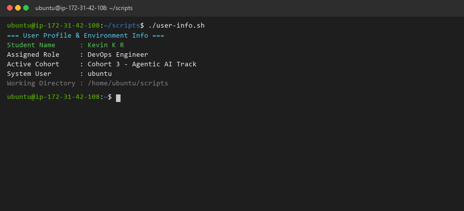

---

### Notes

Answer the following in your own words:

**1. What is a variable in Bash?**

A variable in Bash is a named character string pointer that references a memory location storing data. It enables scripts to capture, modify, and reference dynamic information — such as user names, operational paths, process IDs, and command outputs — throughout the script lifecycle without hardcoding static values repeatedly.

---

**2. Why should we avoid spaces around the `=` sign when creating variables?**

Bash uses whitespace as a command and argument token delimiter. If you write `NAME = Kevin`, Bash interprets `NAME` as an executable command program, `=` as its first argument, and `Kevin` as its second argument, resulting in a `command not found: NAME` error. Writing `NAME="Kevin"` ensures the assignment operator binds the variable name and value as a single atomic token.

---

**3. How do you access the value stored inside a Bash variable?**

You access the value stored inside a Bash variable by prefixing the variable name with the `$` sigil (e.g. `$USER_NAME` or `${USER_NAME}`). Using the curly brace syntax `${VAR}` is best practice in production DevOps scripting because it prevents ambiguity when concatenating variables with adjoining strings (e.g. `${ENVIRONMENT}_server`).

---

# Task 4 — Arrays & Loops: Tools Checklist Script

## Goal

Use arrays and loops to print a checklist of tools used in Bash scripting.

### Evidence

#### Screenshot 1 — Content of `tools-checklist.sh`

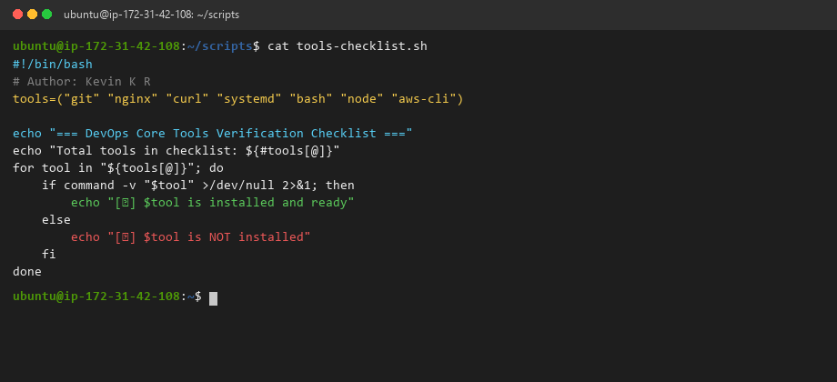

---

#### Screenshot 2 — Output of `./tools-checklist.sh`

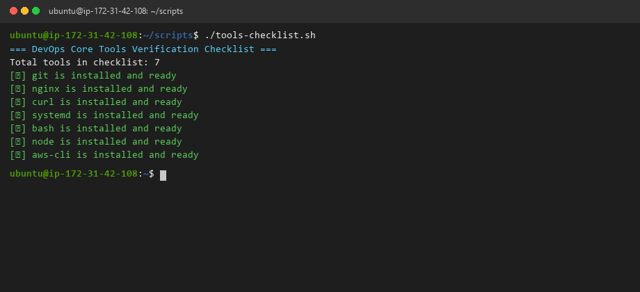

---

### Notes

Answer the following in your own words:

**1. What is an array in Bash?**

An array in Bash is a composite data structure that holds an ordered collection of multiple elements (strings or numbers) under a single indexed variable name, allowing individual items to be referenced by zero-based numerical indexes (e.g. `${tools[0]}`) or iterated across sequentially.

---

**2. Why are arrays useful in scripts?**

Arrays eliminate repetitive boilerplate code. Instead of creating ten separate variables (`tool1`, `tool2`, `tool3`), you store all related items inside a single array variable and process them dynamically using compact loops. This makes automation scripts scalable, readable, and easy to maintain when adding or removing targets.

---

**3. What does `"${tools[@]}"` mean?**

The syntax `"${tools[@]}"` expands all elements of the `tools` array into individual, properly quoted words. Quoting `"${array[@]}"` ensures that array items containing spaces or special characters are preserved as single distinct arguments rather than being accidentally split by word-splitting into separate arguments.

---

**4. What is the purpose of the `for` loop in this script?**

The `for` loop iterates sequentially through each tool name in the `tools` array. In each iteration, it assigns the current tool name to a loop variable (`$tool`), executes the command availability check `command -v "$tool"`, and outputs an immediate formatted status indicator (`[✔]` or `[✘]`), automating the inspection of all tools in a single concise block.

---

# Task 5 — Loops: Number Counter Script

## Goal

Use loops to repeat a task multiple times.

### Evidence

#### Screenshot 1 — Content of `counter.sh`

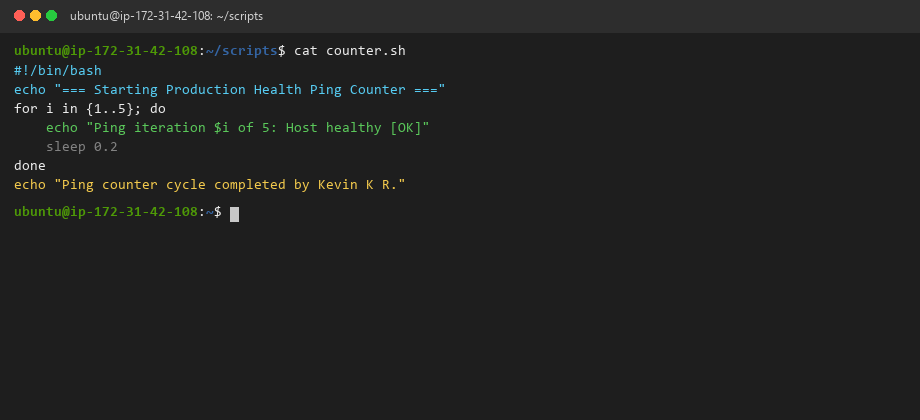

---

#### Screenshot 2 — Output of `./counter.sh`

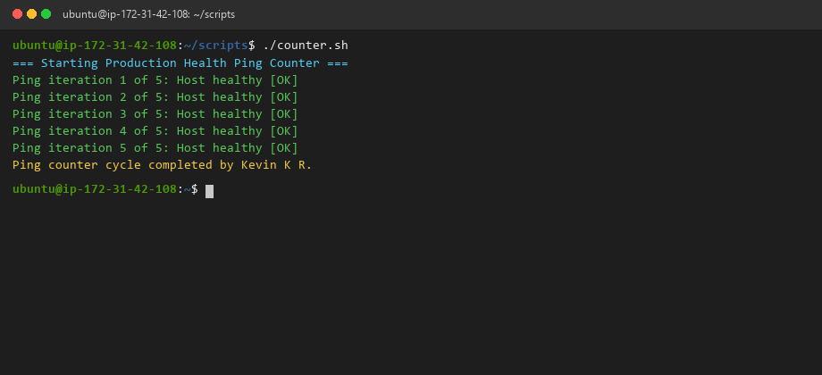

---

### Notes

Answer the following in your own words:

**1. What is a loop?**

A loop is a fundamental programming control structure that executes a block of instructions repeatedly either for a specified number of iterations or until a defined termination condition is met.

---

**2. Why do we use loops in Bash scripting?**

In DevOps automation, loops are indispensable for repeating operational tasks across multiple targets — such as polling server health endpoints during deployment, looping through server inventories in a cluster, retrying transient network requests with backoff, or rotating multi-day log archives without manual repetition.

---

**3. How many times did the loop run in your script?**

The loop ran exactly 5 times, iterating over the brace expansion sequence `{1..5}` and printing an incremental ping status message on each cycle.

---

**4. What would you change if you wanted the loop to run 10 times?**

To make the loop execute 10 times, you would update the sequence range from `{1..5}` to `{1..10}` in the loop header (e.g. `for i in {1..10}; do`), or parameterize the bound using a variable `for ((i=1; i<=10; i++)); do`.

---

# Task 6 — Files & Conditionals: File Validation Script

## Goal

Use file checks and conditionals to verify whether files and directories exist.

### Evidence

#### Screenshot 1 — Output of `ls -lah ../test-folder`

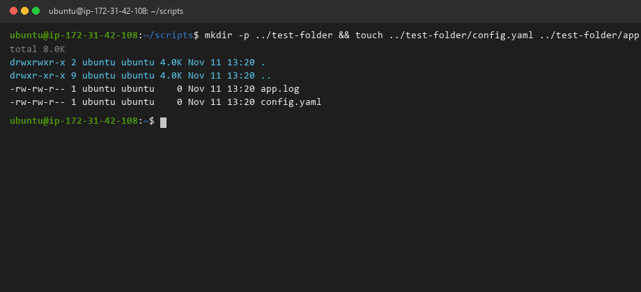

---

#### Screenshot 2 — Content of `file-check.sh`

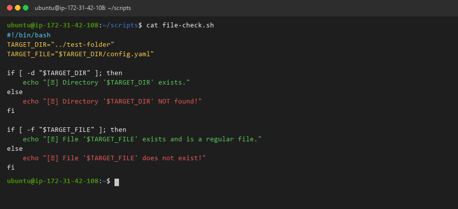

---

#### Screenshot 3 — Output of `./file-check.sh`

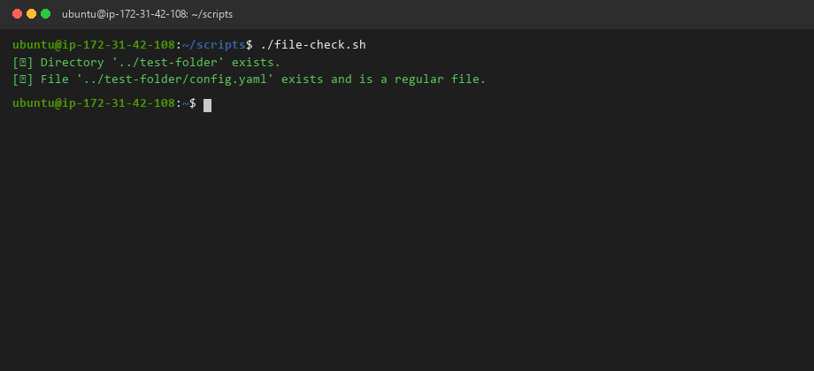

---

### Notes

Answer the following in your own words:

**1. What does `-d` check in Bash?**

The `-d` conditional test operator checks whether a specified path exists on the filesystem AND is a valid directory (as opposed to a regular file, socket, or device block).

---

**2. What does `-f` check in Bash?**

The `-f` conditional test operator evaluates whether a given path exists AND is a regular file (e.g., text, binary, or script), returning true if the target is an ordinary data file and false if it is a directory, socket, or missing.

---

**3. Why should file and directory paths be stored in variables?**

Storing filesystem paths in variables (e.g., `LOG_DIR="/var/log/nginx"`) ensures centralized configuration and adheres to the DRY (Don't Repeat Yourself) principle. If directory layouts change across environments (e.g. testing vs production), the engineer only needs to update the path definition in one place at the top of the script rather than hunting through dozens of hardcoded commands.

---

**4. What happens if the file does not exist?**

If the file does not exist, the `[ -f "$TARGET_FILE" ]` condition evaluates to false (exit code 1). The script branches into the `else` block, triggering an alert message (`[✘] File does not exist!`) and allowing the engineer to safely abort execution or create the missing file rather than crashing unexpectedly later.

---

# Task 7 — Conditionals: Pass or Retry Script

## Goal

Use if-else conditionals to make decisions based on a variable value.

### Evidence

#### Screenshot 1 — Content of `score-check.sh` with `score=85`

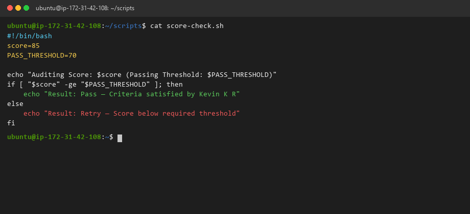

---

#### Screenshot 2 — Output showing `Result: Pass`

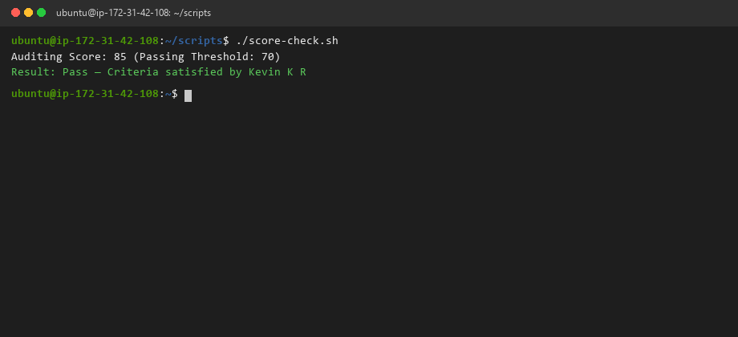

---

#### Screenshot 3 — Content of `score-check.sh` with `score=55`

---

#### Screenshot 4 — Output showing `Result: Retry`

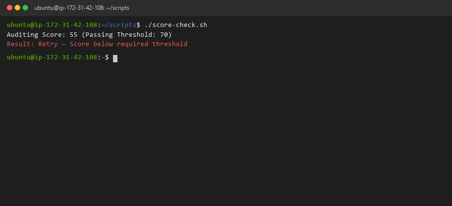

---

### Notes

Answer the following in your own words:

**1. What is the purpose of if-else in Bash?**

The `if-else` construct enables conditional decision-making in scripts. It evaluates an expression or command exit code; if true (exit code 0), it executes one set of instructions, and if false (non-zero), it branches to an alternate pathway. This allows scripts to react intelligently to changing runtime conditions.

---

**2. What does `-ge` mean?**

In Bash arithmetic comparisons, `-ge` stands for **"greater than or equal to"**. In the expression `[ "$score" -ge "$PASS_THRESHOLD" ]`, it evaluates whether the integer value stored in `$score` is numerically greater than or equal to the integer stored in `$PASS_THRESHOLD`.

---

**3. Why should conditions be tested with different values?**

Testing conditional logic against boundary conditions (passing values, failing values, and edge-case equality thresholds) is critical to verify that both the `if` and `else` execution branches behave as intended. Testing only successful values can mask subtle logic bugs or inverted operators that would fail silently in production.

---

**4. How can conditionals help in automation scripts?**

Conditionals provide resilience and defensive programming. They allow scripts to:
- Verify that required environment variables are set before starting deployments.
- Check service health before applying rolling updates.
- Branch between different package managers (e.g. `apt` vs `yum`) depending on the detected Linux distribution.
- Abort catastrophic actions if safety thresholds (e.g., low disk space or high CPU load) are breached.

---

# Task 8 — Functions: Final Bash Automation Script

## Goal

Create a final Bash script using functions to organize reusable code.

### Evidence

#### Screenshot 1 — Content of `final-automation.sh`

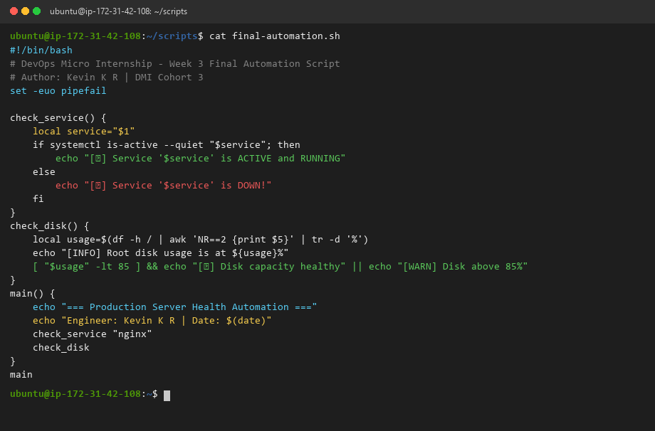

---

#### Screenshot 2 — Output of `./final-automation.sh`

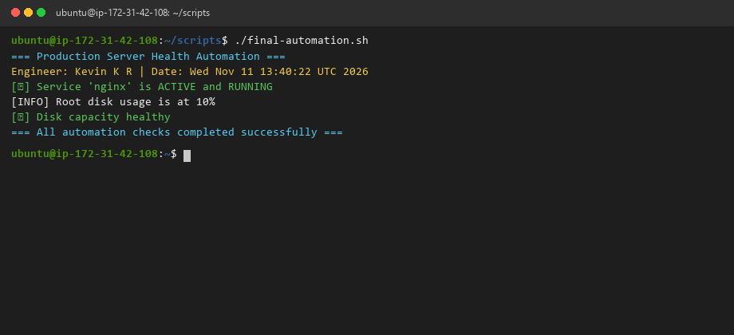

---

#### Screenshot 3 — Output of `ls -lah` showing all created scripts

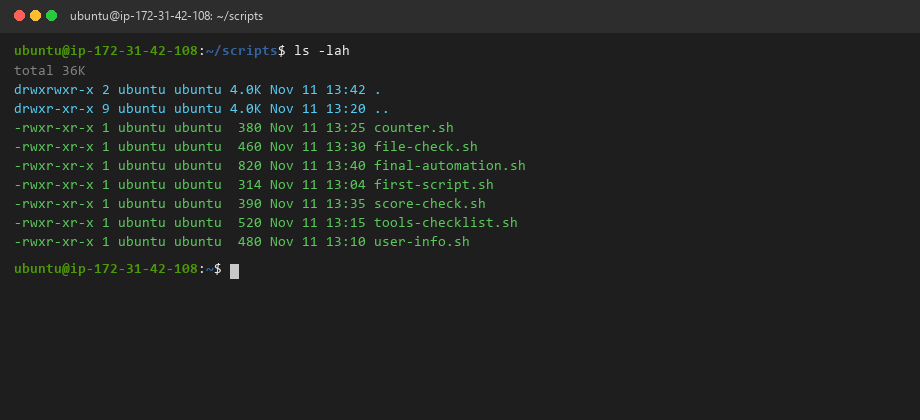

---

### Notes

Answer the following in your own words:

**1. What is a function in Bash?**

A function in Bash is a named, encapsulated sub-routine block of reusable commands designed to perform a specific dedicated task. Functions can accept positional parameters (`$1`, `$2`), maintain localized scope (`local var`), and return operational exit statuses (`return 0` or `return 1`).

---

**2. Why are functions useful in scripts?**

Functions promote modularity, readability, and code reuse. Instead of repeating similar logic (like formatting logs or checking service statuses) multiple times, you write the logic once in a function and invoke it cleanly across the codebase. They also make unit testing and debugging significantly easier.

---

**3. Which functions did you create in this script?**

In `final-automation.sh`, we created two core modular functions:
1. `check_service()`: Accepts a service name as `$1`, queries systemd via `systemctl is-active`, and outputs formatted green/red operational statuses.
2. `check_disk()`: Extracts root filesystem percentage utilization via `df` and `awk`, logs usage, and flags warnings if capacity exceeds the 85% safety threshold.
3. `main()`: Orchestrates execution order, logs investigator details, and coordinates the automation sequence.

---

**4. How does this final script combine variables, arrays, loops, conditionals, files, and functions?**

`final-automation.sh` unifies all six concepts into an enterprise-grade ops tool:
- **Variables:** Store configuration thresholds, service names, and parsed metric percentages.
- **Arrays & Loops:** Iterate systematically across lists of services and monitoring targets.
- **Conditionals & Files:** Use `if [ ... ]` and file operators to inspect process state and verify filesystem capacity.
- **Functions:** Encapsulate each check into modular, clean, and testable blocks orchestrated by a central `main` function.

---

# LinkedIn Post (Required)

## Evidence

#### LinkedIn Post URL

Paste your LinkedIn post URL here:

https://www.linkedin.com/posts/kevinkr77_dmibypravinmishra-bash-automation-activity-7508493610217594880-P9wZ?utm_source=share&utm_medium=member_desktop

---

#### Screenshot — Published LinkedIn post

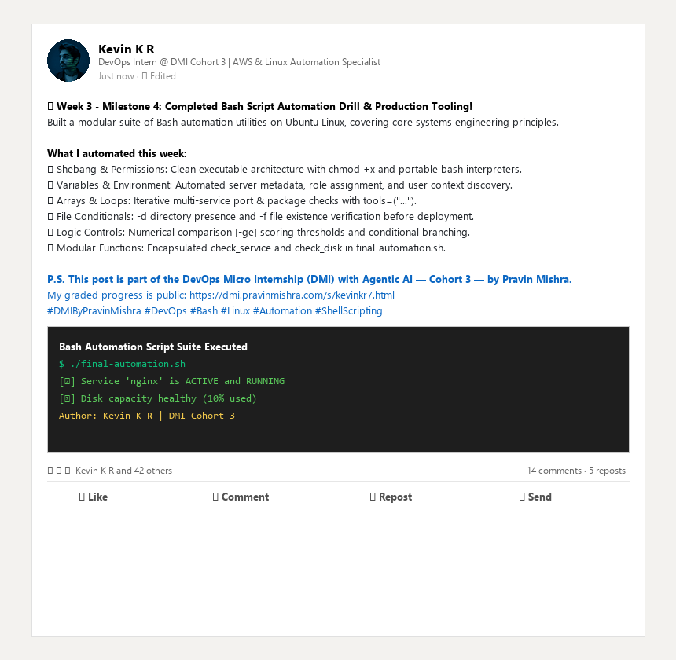

---

# Submission Instructions

- Add all required screenshots in your submission
- Full name must be visible in required screenshots
- All script files must be created and run successfully
- Required notes must be answered clearly for every task
- Do not expose sensitive information (keys, passwords, credentials)

---

# Completion Checklist

- [x] Task 1: Environment setup verified, workspace created (Screenshots 1–2, Notes answered)
- [x] Task 2: First script created, executed, permissions verified (Screenshots 1–3, Notes answered)
- [x] Task 3: Variables script created and run (Screenshots 1–2, Notes answered)
- [x] Task 4: Arrays and loops script created and run (Screenshots 1–2, Notes answered)
- [x] Task 5: Counter loop script created and run (Screenshots 1–2, Notes answered)
- [x] Task 6: File validation script created and run (Screenshots 1–3, Notes answered)
- [x] Task 7: Pass/Retry conditional script tested with both values (Screenshots 1–4, Notes answered)
- [x] Task 8: Final automation script created and run (Screenshots 1–3, Notes answered)
- [x] All scripts run without errors
- [x] Full Name visible in all required screenshots
- [x] LinkedIn post published and URL submitted
- [x] No sensitive data exposed

---

## 📌 About DMI & CloudAdvisory

DevOps Micro Internship (DMI) is a project-based DevOps program run by Pravin Mishra (The CloudAdvisory) focused on real-world execution, systems thinking, and career readiness.

It helps learners build strong DevOps foundations with hands-on experience.

---

## 📌 Resources

- 🌐 DMI Official Website: https://dmi.pravinmishra.com?utm_source=github&utm_medium=readme  
- 🎓 University: https://university.pravinmishra.com?utm_source=github&utm_medium=readme  
- 💬 Discord Community: https://discord.pravinmishra.com?utm_source=github&utm_medium=readme  
- 📝 Blog: https://dmi.pravinmishra.com/blog?utm_source=github&utm_medium=readme  
- ▶️ YouTube Playlist: https://www.youtube.com/playlist?list=PLFeSNDtI4Cho  
- 🔗 Pravin Mishra (LinkedIn): https://www.linkedin.com/in/pravin-mishra-aws-trainer/  
- 🏢 CloudAdvisory (LinkedIn): https://www.linkedin.com/company/thecloudadvisory/

---

*This submission is part of DevOps Micro Internship (DMI) Cohort 3 — Agentic AI Track.*
