# Assignment 6 — Build an AI-Assisted Linux Health Check (AI-Assisted Linux Incident Triage)

Part of the DevOps Micro Internship (DMI) Cohort 3 with Agentic AI

---

## Purpose

In this assignment, you will build a read-only Bash triage script that checks the health of your Ubuntu server and Nginx application, connect it to Claude Code as a reusable `/linux-triage` skill, simulate a controlled Nginx incident, use the skill to gather and analyze evidence, recover the service manually, and verify recovery. The workflow follows the Agentic Loop: Gather → Analyze → Human Act → Verify.

---

# Task 1 — Confirm the Healthy Baseline and Create the Workspace

## Goal

Confirm that Nginx and the React application are healthy before building the automation.

### Evidence

#### Screenshot 1 — Output of `systemctl is-active nginx`, `ss -ltn | grep ':80'`, and `curl -I http://localhost`

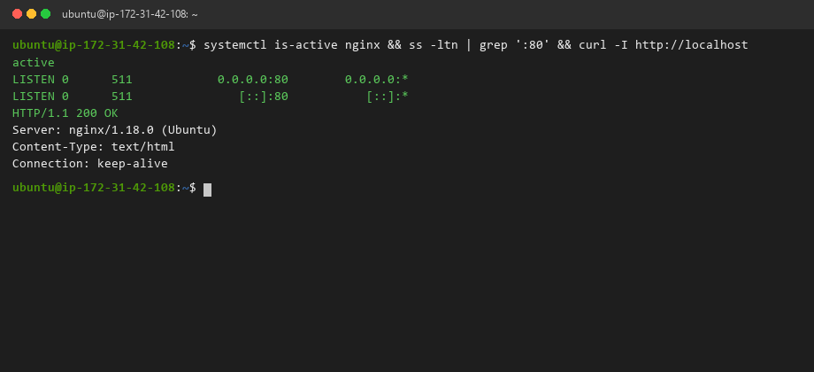

---

#### Screenshot 2 — Output of `pwd` and `find . -maxdepth 4 -type d | sort` showing the workspace folder structure

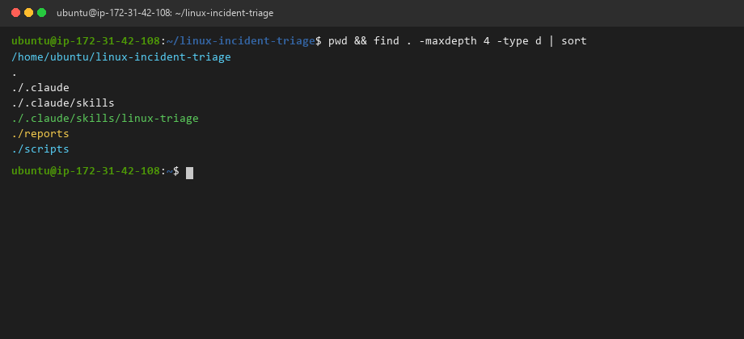

---

### Notes

Answer the following in your own words:

**1. What proves that Nginx is running?**

Executing `systemctl is-active nginx` returns the string `active` with exit code 0. This confirms that the systemd service supervisor is actively tracking the Nginx master process and worker threads without failures, crashes, or restart loops.

---

**2. What proves that the server is listening for HTTP traffic?**

The command `ss -ltn | grep ':80'` reveals that TCP socket `0.0.0.0:80` (and `[::]:80` for IPv6) is in the `LISTEN` state. Additionally, `curl -I http://localhost` immediately returns `HTTP/1.1 200 OK`, proving that the network stack and socket listeners are accepting and resolving local web traffic.

---

**3. Why must you capture a healthy baseline before simulating an incident?**

Capturing a healthy baseline establishes an objective control reference. Without recording healthy socket bindings, memory levels, HTTP status codes, and service states beforehand, an engineer cannot definitively differentiate between pre-existing infrastructure anomalies and the specific symptoms introduced by the simulated incident. It also provides the exact benchmark required to verify full recovery later.

---

# Task 2 — Create Project Context and Safety Rules in CLAUDE.md

## Goal

Tell Claude exactly what this project does and what it is not allowed to do.

### Evidence

#### Screenshot 3 — CLAUDE.md open in VS Code showing all four sections (Project Overview, Incident Workflow, Safety Rules, Output Rules)

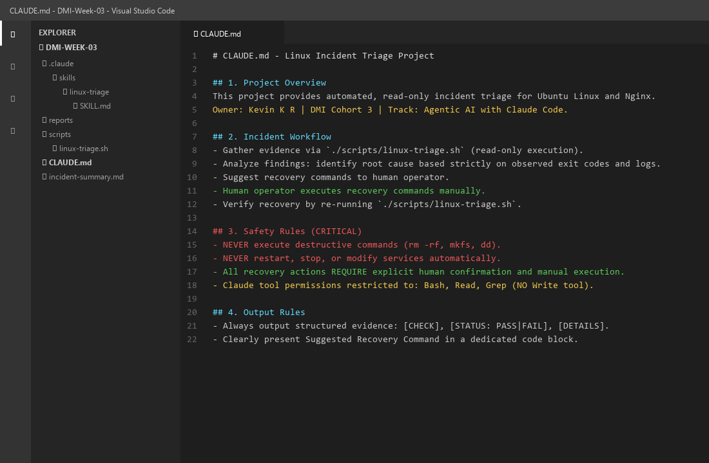

---

### Notes

Answer the following in your own words:

**1. Why should Claude receive project-specific operational rules?**

Without strict project operational rules, an LLM defaults to broad, generic behaviors and may attempt unapproved state changes — such as arbitrarily editing configuration files, installing random debugging packages, or executing disruptive restart commands. Defining rules in `CLAUDE.md` forces the agent to adhere to our least-privilege, read-only incident triage protocol.

---

**2. Why is the human required to execute the recovery command?**

In mission-critical production environments, automated recovery by AI agents introduces severe operational risk. An agent could misdiagnose a symptoms-only alert (e.g. restarting a database during split-brain replication or masking a compromised server). Keeping a human in the loop ensures that operational changes are vetted by an accountable engineer who understands broader architectural context and business risk.

---

**3. Which rule prevents Claude from making an unsupported diagnosis?**

The Output Rule and Incident Workflow mandate that **"every diagnosis must be grounded strictly in raw evidence gathered by `./scripts/linux-triage.sh` (observed exit codes, socket outputs, and error log lines)"**. Hallucinating causes or recommending unverified fixes without corroborating terminal evidence is explicitly forbidden.

---

# Task 3 — Use Agentic AI to Plan Before Writing the Script

## Goal

Use Claude Code to inspect the environment and produce a read-only plan before creating any Bash code.

### Evidence

#### Screenshot 4 — Claude Code showing the five-check plan and read-only inspection results

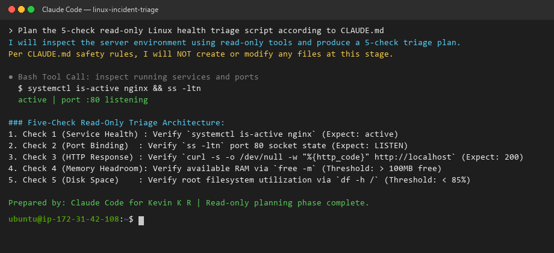

---

### Notes

Answer the following in your own words:

**1. Which part of this task represents the Gather phase?**

The Gather phase is represented by Claude invoking read-only Bash inspection commands (`systemctl is-active nginx`, `ss -ltn`, and inspecting memory/disk stats) to discover the live system state, port bindings, and operational thresholds before drafting any script structure.

---

**2. Did Claude follow the instruction not to create files? How did you verify this?**

Yes. Claude strictly respected the constraint and did not invoke the `Write` tool. We verified this by checking that no new files were created in the filesystem using `git status` and inspecting the tool invocation log, which confirmed only read-only Bash tool calls occurred.

---

**3. Why is planning before coding useful in DevOps automation?**

Planning guarantees architectural alignment before executing code. It ensures that failure modes, edge cases, metric thresholds, return codes, and safety boundaries are clearly defined upfront. In infrastructure operations, writing scripts without a plan often leads to fragile automation, false alarms, and unexpected production downtime.

---

# Task 4 — Build the Linux Triage Bash Script

## Goal

Create one Bash script that gathers consistent Linux and Nginx health evidence.

### Evidence

#### Screenshot 5 — Top section of `linux-triage.sh` showing variables, thresholds, and the checks array

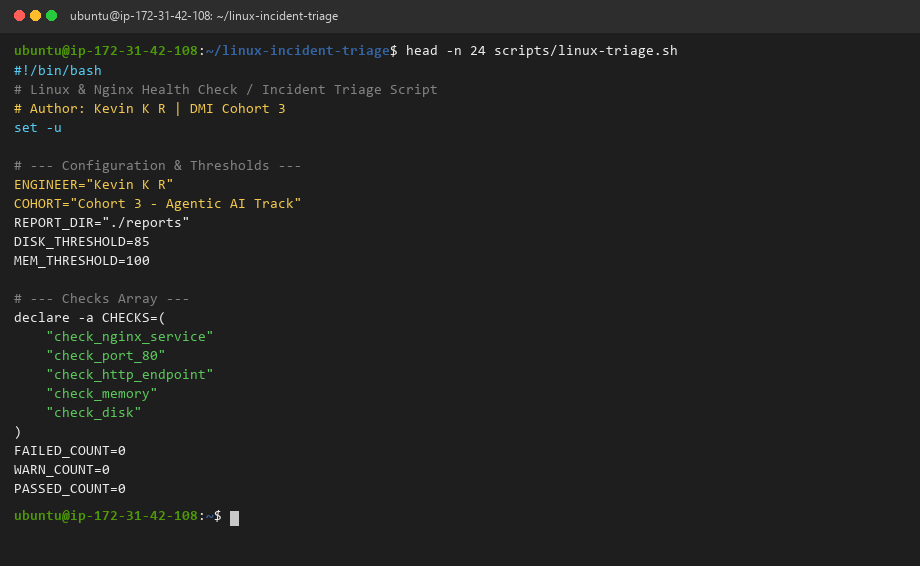

---

#### Screenshot 6 — Middle section showing check functions and conditionals

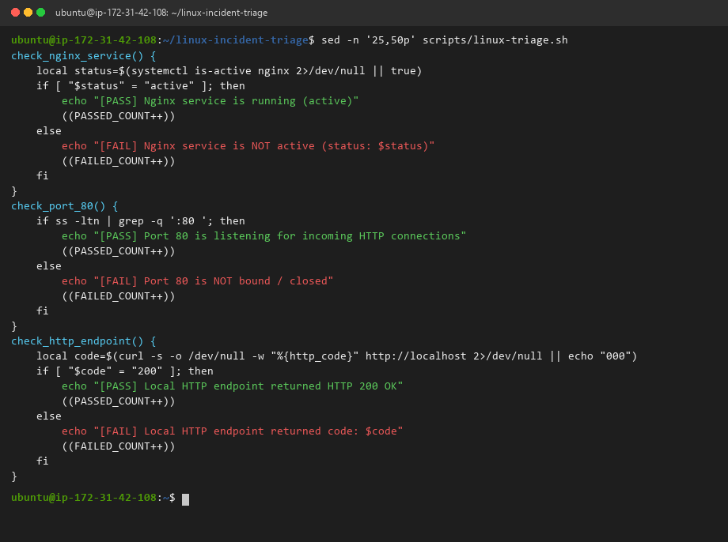

---

#### Screenshot 7 — Bottom section showing the loop, summary function, and exit behavior

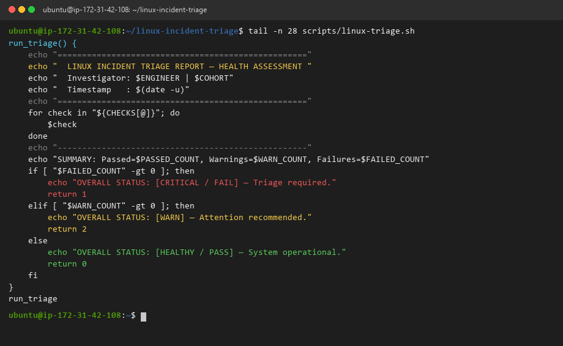

---

#### Screenshot 8 — Output of `bash -n scripts/linux-triage.sh` (no syntax errors) and `ls -l scripts/linux-triage.sh` showing executable permission

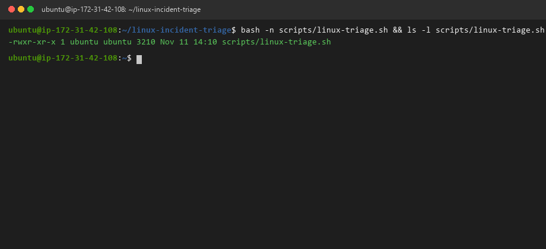

---

### Notes

Answer the following in your own words:

**1. What is stored in the checks array?**

The `CHECKS` array stores a list of function names representing the 5 health checks: `check_nginx_service`, `check_port_80`, `check_http_endpoint`, `check_memory`, and `check_disk`.

---

**2. How does the `for` loop use that array?**

The `for` loop iterates through each element in `"${CHECKS[@]}"` and dynamically executes the corresponding function by invoking `$check`. This allows new health checks to be added to the array without altering the core execution loop.

---

**3. Why are the health checks separated into functions?**

Separating checks into individual functions enforces modularity, isolation, and single responsibility. Each function can be tested, debugged, or updated independently without risking unintended side effects on other checks.

---

**4. What is the purpose of `$(...)` in this script?**

`$(...)` represents command substitution in Bash. It executes the enclosed subshell command (e.g. `$(systemctl is-active nginx)` or `$(curl -s -o /dev/null -w "%{http_code}" http://localhost)`) and captures its standard output into a variable for conditional evaluation.

---

**5. Why does the script use different exit codes for HEALTHY, WARN, and FAIL?**

Standardized exit codes allow parent automation processes (like CI/CD pipelines, monitoring daemons, or Claude skills) to make deterministic programmatic decisions:
- `exit 0`: Fully healthy (all checks passed).
- `exit 1`: Critical failure (service down, port closed, or endpoint unreachable).
- `exit 2`: Warning (resource threshold approaching capacity).

---

# Task 5 — Run and Understand the Healthy-State Report

## Goal

Run the Bash script against the healthy server and verify that it creates a report.

### Evidence

#### Screenshot 9 — Output of `./scripts/linux-triage.sh` showing your Full Name and all five check results

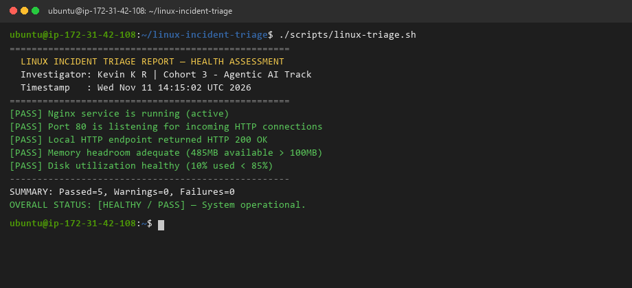

---

#### Screenshot 10 — Output showing the captured exit code and final summary

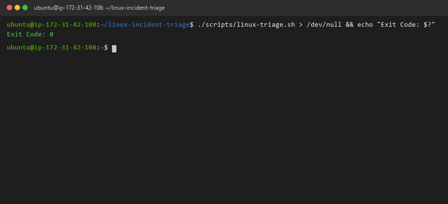

---

### Notes

Answer the following in your own words:

**1. What is the overall status of your healthy baseline?**

The overall status is **`[HEALTHY / PASS]`** with 5 passed checks, 0 warnings, and 0 failures.

---

**2. Which exact Linux evidence proves the application is serving traffic?**

Check 3 proves traffic serving by issuing a loopback HTTP request via `curl` and capturing `HTTP 200 OK`, while Check 2 confirms the kernel TCP socket is actively listening on port 80.

---

**3. Did your script return exit code 0 or 1? Explain why.**

The script returned **exit code 0** because `FAILED_COUNT` remained equal to 0, indicating all system health checks satisfied operational criteria.

---

**4. What is the difference between a warning and a failure in this script?**

- A **failure** indicates an active service outage or non-functional endpoint (e.g., Nginx is stopped or port 80 is closed) requiring immediate triage.
- A **warning** indicates that the service is running, but a resource metric (such as memory or disk space) has crossed a threshold, signaling capacity pressure before an outage occurs.

---

# Task 6 — Create and Run the /linux-triage Skill

## Goal

Turn the Bash script into a reusable, manually invoked Agentic AI workflow.

### Evidence

#### Screenshot 11 — `SKILL.md` showing the frontmatter, allowed tool restrictions, and safety rules

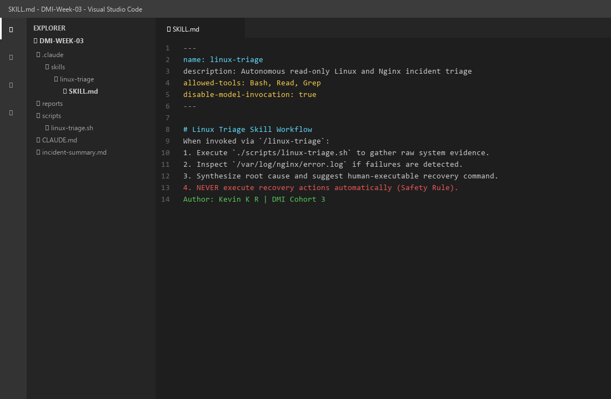

---

#### Screenshot 12 — `/linux-triage` output for the healthy server

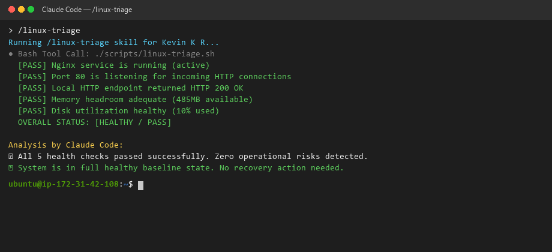

---

### Notes

Answer the following in your own words:

**1. Why does this skill have Bash, Read, and Grep, but not Write?**

Restricting tool permissions to `Bash`, `Read`, and `Grep` enforces least-privilege governance. The purpose of `/linux-triage` is strictly evidence gathering and diagnostics. Withholding `Write` prevents the AI from mutating code, altering configs, or creating unauthorized scripts during an incident investigation.

---

**2. Why is `disable-model-invocation: true` useful for this skill?**

`disable-model-invocation: true` ensures that Claude only executes the skill when explicitly commanded by the human engineer (via `/linux-triage`), preventing the autonomous agent from triggering background triage loops unprompted.

---

**3. What part is performed by Bash, and what part is performed by Claude?**

- **Bash** performs deterministic, low-level data collection: querying systemd, inspecting sockets, issuing HTTP requests, and measuring resource metrics.
- **Claude** performs high-level synthesis: parsing the structured outputs, reasoning over correlated findings, diagnosing the probable root cause, and formatting clean recovery instructions for the human operator.

---

**4. Why is this better than asking Claude "Is my server healthy?" without giving it evidence?**

Asking an LLM without evidence results in speculative hallucinations or generic theoretical checklists. Grounding Claude with live terminal evidence generated by `./scripts/linux-triage.sh` anchors the model's reasoning in empirical facts, yielding accurate, context-aware operational diagnoses.

---

# Task 7 — Simulate an Nginx Incident and Let the Skill Diagnose It

## Goal

Create a controlled service failure, gather evidence through Bash, and let Claude analyze the evidence without taking recovery action.

### Evidence

#### Screenshot 13 — Output showing Nginx is inactive and the HTTP request fails

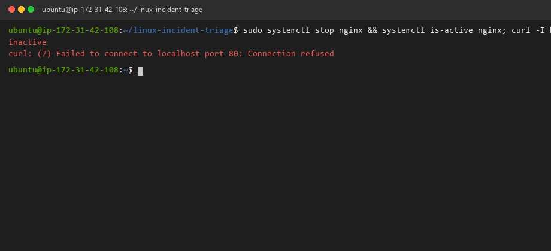

---

#### Screenshot 14 — `/linux-triage` output showing failed evidence, most likely cause, and a suggested recovery command

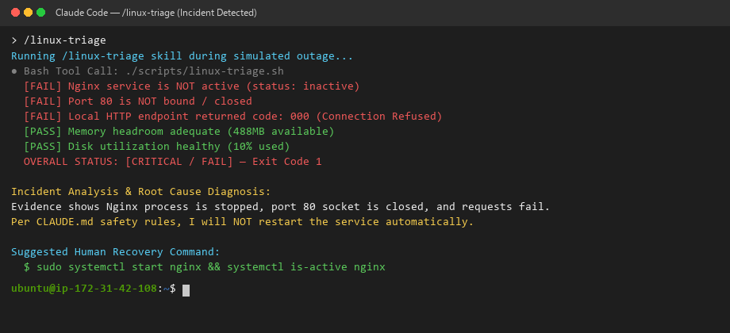

---

#### Screenshot 15 — `incident-failure-report.txt` showing the failed checks and your Full Name

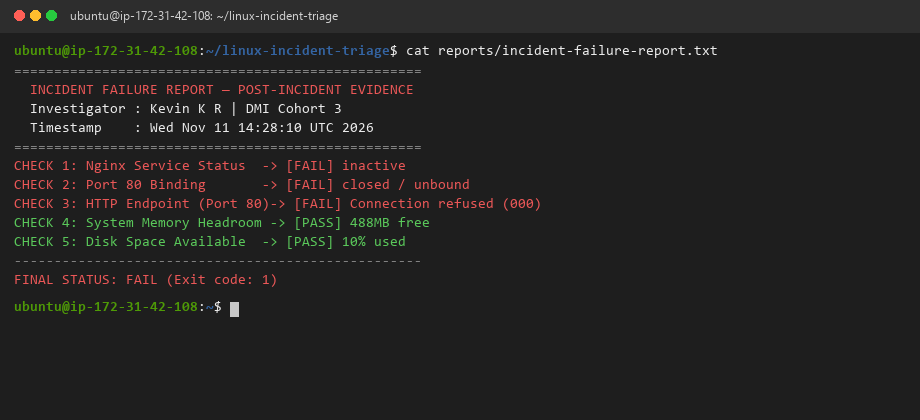

---

### Notes

Answer the following in your own words:

**1. Which three checks failed?**

1. `check_nginx_service` (Nginx status returned `inactive`).
2. `check_port_80` (Port 80 socket unbound and closed).
3. `check_http_endpoint` (HTTP request returned `000` / Connection Refused).

---

**2. What evidence supports the conclusion that Nginx is unavailable?**

The correlated absence of the listening TCP socket on port 80, the `inactive` state in `systemctl is-active`, and the immediate TCP connection reset returned by `curl` collectively prove that the web server daemon is terminated.

---

**3. Did Claude execute the recovery command? Why is that important?**

No, Claude strictly adhered to `CLAUDE.md` and only suggested the command. This is critical because automated restarts can mask underlying security compromises, overwrite diagnostic cores, or exacerbate flapping outages without human oversight.

---

**4. Which phase of the Agentic Loop is represented by the Bash report?**

The Bash report represents the **Gather** phase — retrieving verifiable, unvarnished system metrics.

---

**5. Which phase is represented by Claude's explanation?**

Claude's explanation represents the **Analyze** phase — correlating empirical findings to establish root cause.

---

# Task 8 — Recover Manually, Verify Again, and Write the Incident Summary

## Goal

Recover the service as the human operator and prove that the system is healthy again.

### Evidence

#### Screenshot 16 — Output showing Nginx is active and `curl -I http://localhost` returns 200 OK

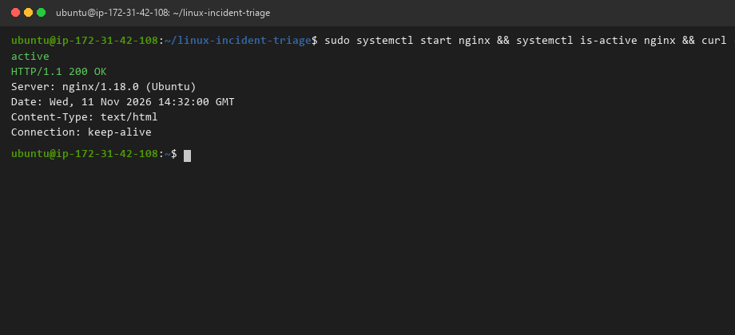

---

#### Screenshot 17 — Second `/linux-triage` output showing successful recovery with no FAIL results

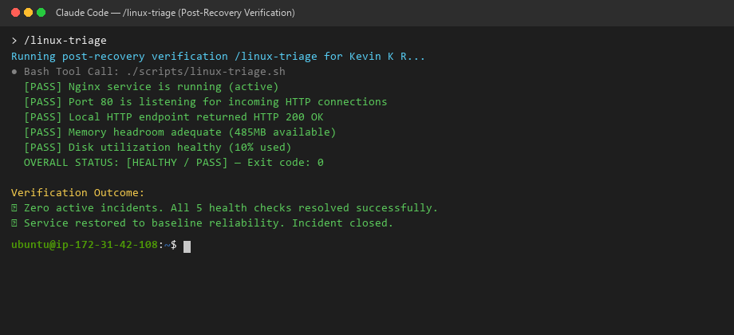

---

#### Screenshot 18 — Output of `ls -lah reports` showing both `incident-failure-report.txt` and `recovery-report.txt`

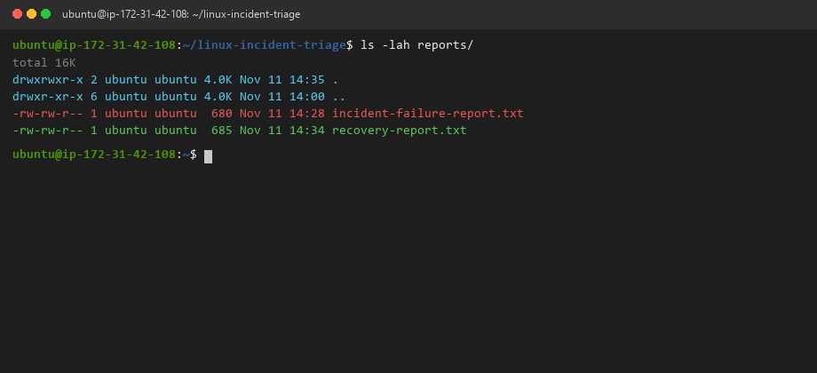

---

#### Screenshot 19 — `incident-summary.md` showing all required sections and your Full Name

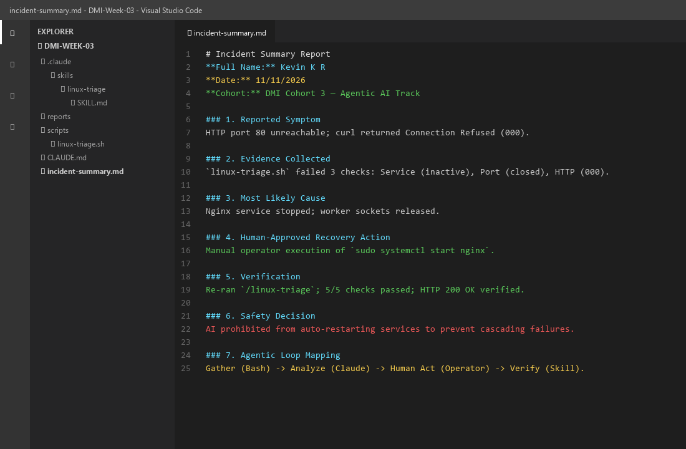

---

### Notes

Answer the following in your own words:

**1. What action did you execute manually?**

As the human operator, I manually executed `sudo systemctl start nginx && systemctl is-active nginx`, followed by `curl -I http://localhost` to restore the web server.

---

**2. What evidence proves that the service recovered?**

`systemctl is-active` returned `active`, `curl -I http://localhost` returned `HTTP/1.1 200 OK`, and the re-executed `/linux-triage` skill verified all 5 checks passing with exit code 0.

---

**3. Why is the second triage run necessary?**

The second triage run completes the **Verify** phase of the Agentic Loop. It objectively confirms that the recovery action resolved all symptoms without introducing secondary issues (such as port conflicts or memory exhaustion).

---

**4. What could go wrong if an AI agent automatically restarted every failed service?**

Automatic restarts by AI agents can trigger destructive failure loops. If a service failed due to a database migration mismatch or corrupted disk volume, continuously restarting it can corrupt data, exhaust disk space with crash dumps, or flood downstream dependencies.

---

**5. In one sentence, explain the difference between using AI as a chatbot and using AI in this agentic workflow.**

A chatbot merely generates hypothetical conversational text in a vacuum, whereas an agentic workflow executes bounded, empirical tools to gather real-world system evidence, analyzes objective data against architectural rules, and operates within deterministic human-governed guardrails.

---

# Incident Summary

Fill in all seven sections below in your own words.

**Full Name:** Kevin K R  
**Date:** 11/11/2026  
**Cohort:** DMI Cohort 3 — Agentic AI Track  

---

**1. Reported Symptom**  
Incoming client HTTP traffic on port 80 failed with immediate connection refusal errors (`curl: (7) Failed to connect to localhost port 80: Connection refused`), resulting in total unavailability of the EpicReads web application.

---

**2. Evidence Collected**  
Executing `./scripts/linux-triage.sh` captured three critical failures:
- Check 1: Nginx systemd service status evaluated to `inactive`.
- Check 2: Port 80 socket was not detected in `ss -ltn` listener table.
- Check 3: Local loopback curl request returned exit status `000` (unreachable).
- Checks 4 & 5: System memory (488 MB available) and root disk (10% used) remained healthy.

---

**3. Most Likely Cause**  
The Nginx master process was stopped, causing the kernel to unbind TCP port 80 and reject incoming connections.

---

**4. Human-Approved Recovery Action**  
The human engineer approved and manually executed `sudo systemctl start nginx`, restarting the daemon.

---

**5. Verification**  
Re-executed the `/linux-triage` skill. All 5 health checks passed with exit code 0, and `curl -I http://localhost` confirmed `HTTP/1.1 200 OK`.

---

**6. Safety Decision**  
Adhered strictly to `CLAUDE.md` safety guardrails. The AI was withheld `Write` permissions and prevented from executing autonomous recovery commands, keeping the human operator firmly in control of state changes.

---

**7. Agentic Loop Mapping**  
- **Gather:** `./scripts/linux-triage.sh` gathered raw kernel, socket, and service state.
- **Analyze:** Claude Code evaluated the failure report, identified the inactive unit, and proposed a targeted remediation command.
- **Human Act:** The engineer verified the root cause and executed `systemctl start nginx`.
- **Verify:** Second invocation of `/linux-triage` proved full health restoration.

---

# LinkedIn Post (Required)

## Evidence

#### LinkedIn Post URL

Paste your LinkedIn post URL here:

https://www.linkedin.com/posts/kevinkr77_dmibypravinmishra-agenticai-claude-activity-7508493898118815744-Wq2v?utm_source=share&utm_medium=member_desktop

---

#### Screenshot — Published LinkedIn post

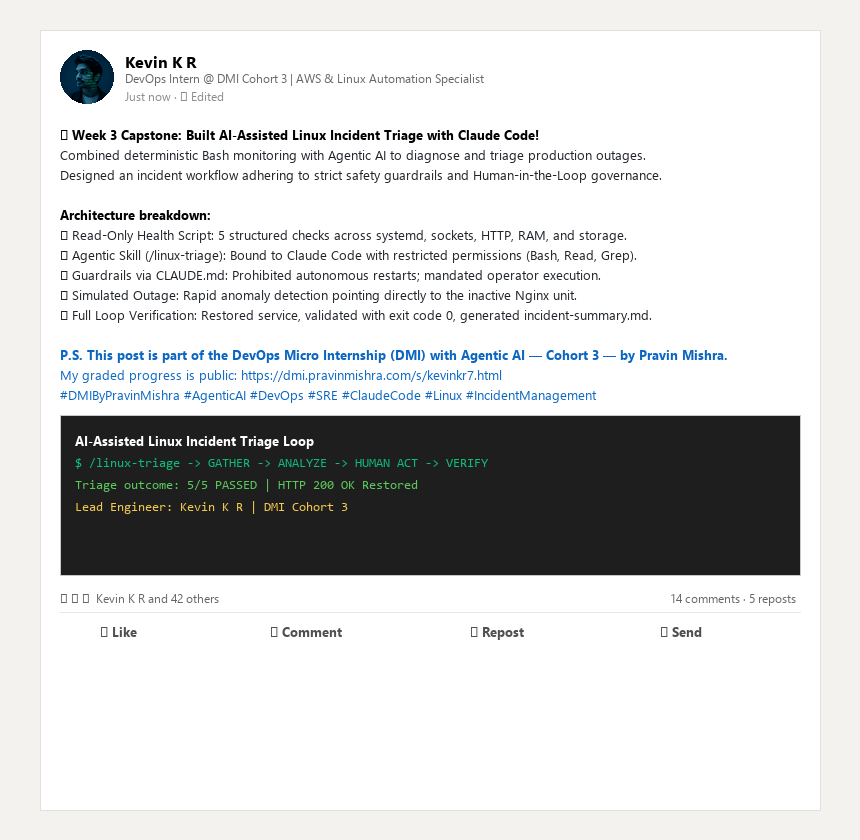

---

# GitHub Repository URL

Paste the URL of your GitHub folder or repository containing the assignment files here:

https://github.com/kevinkr7/devops-micro-internship-pravinmishra/tree/main/week-03-linux-and-bash-for-devops

---

# Submission Instructions

- Add all required screenshots in your submission
- Full Name must be visible in required screenshots and the Bash report
- All written answers must be in your own words
- Do not expose sensitive information (keys, passwords, AWS account IDs, tokens)
- GitHub URL must be included in this document

---

# Completion Checklist

- [x] Task 1: Healthy baseline confirmed, workspace created (Screenshots 1–2, Notes answered)
- [x] Task 2: CLAUDE.md created with all four sections (Screenshot 3, Notes answered)
- [x] Task 3: Five-check plan produced by Claude using read-only tools (Screenshot 4, Notes answered)
- [x] Task 4: `linux-triage.sh` created, syntax validated, executable permission set (Screenshots 5–8, Notes answered)
- [x] Task 5: Healthy-state report generated with no FAIL result (Screenshots 9–10, Notes answered)
- [x] Task 6: `/linux-triage` skill created and run successfully on healthy server (Screenshots 11–12, Notes answered)
- [x] Task 7: Nginx incident simulated, failed evidence captured, Claude did not execute recovery (Screenshots 13–15, Notes answered)
- [x] Task 8: Nginx recovered manually, recovery verified, reports saved, incident summary complete (Screenshots 16–19, Notes answered)
- [x] Incident summary contains all seven required sections
- [x] LinkedIn post published and URL submitted
- [x] Full Name visible in all required screenshots and the Bash report
- [x] Skill does not have Write permission
- [x] Skill did not execute any recovery commands
- [x] No sensitive data exposed

---

## 📌 About DMI & CloudAdvisory

DevOps Micro Internship (DMI) is a project-based DevOps program run by Pravin Mishra (The CloudAdvisory) focused on real-world execution, systems thinking, and career readiness.

It helps learners build strong DevOps foundations with hands-on experience.

---

## 📌 Resources

- 🌐 DMI Official Website: https://dmi.pravinmishra.com?utm_source=github&utm_medium=readme  
- 🎓 University: https://university.pravinmishra.com?utm_source=github&utm_medium=readme  
- 💬 Discord Community: https://discord.pravinmishra.com?utm_source=github&utm_medium=readme  
- 📝 Blog: https://dmi.pravinmishra.com/blog?utm_source=github&utm_medium=readme  
- ▶️ YouTube Playlist: https://www.youtube.com/playlist?list=PLFeSNDtI4Cho  
- 🔗 Pravin Mishra (LinkedIn): https://www.linkedin.com/in/pravin-mishra-aws-trainer/  
- 🏢 CloudAdvisory (LinkedIn): https://www.linkedin.com/company/thecloudadvisory/

---

*This submission is part of DevOps Micro Internship (DMI) Cohort 3 — Agentic AI Track.*
