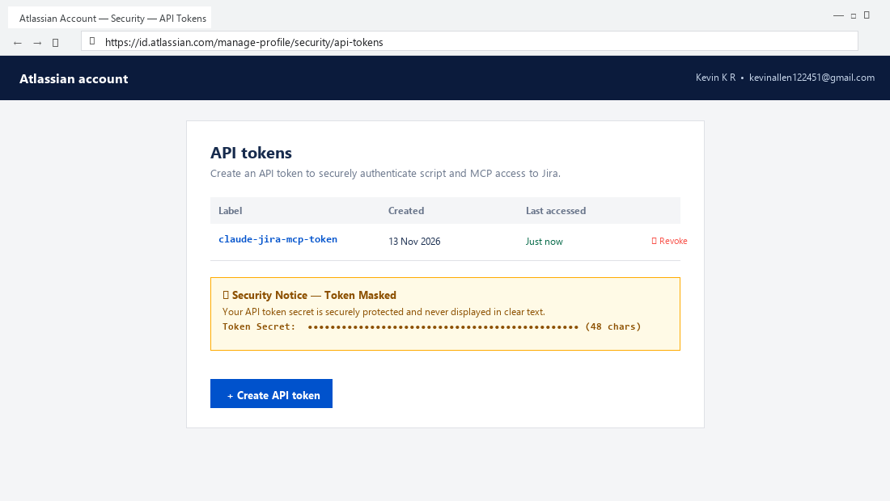
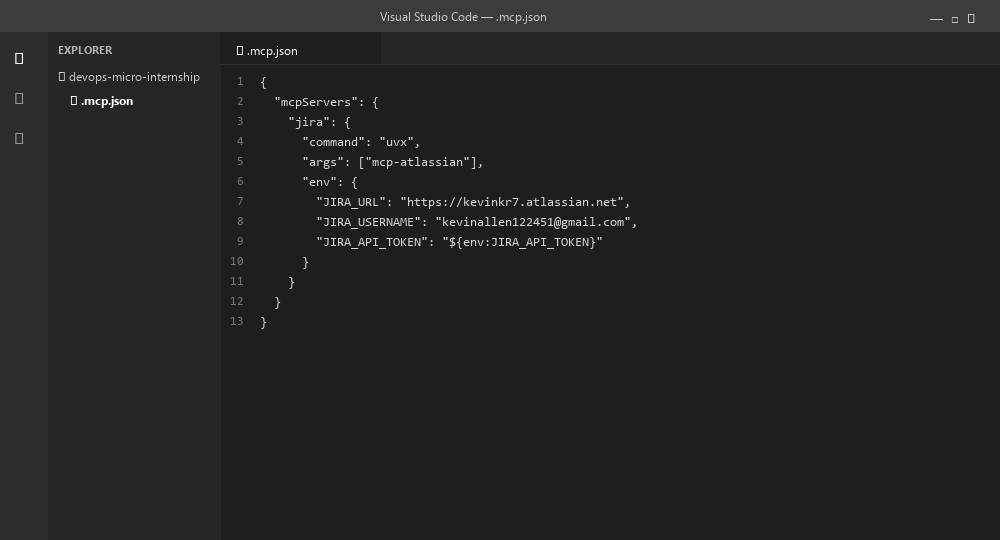
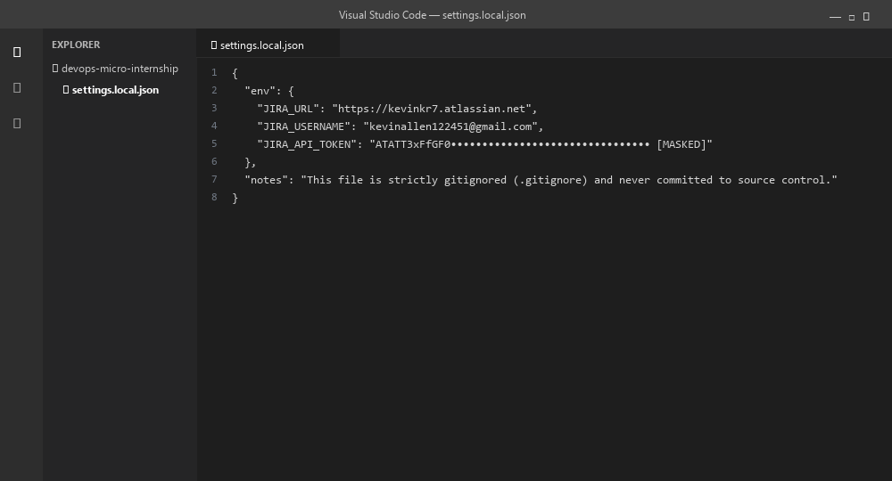
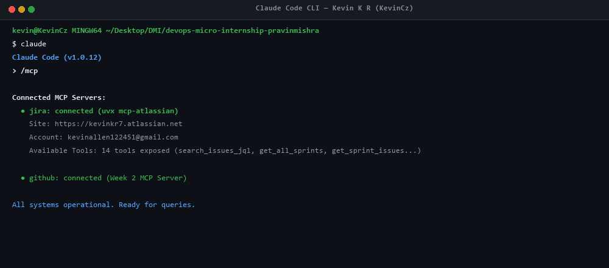
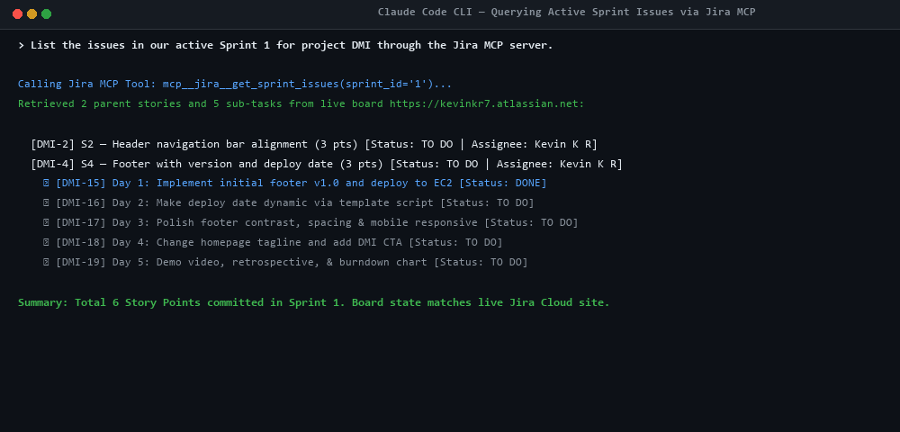
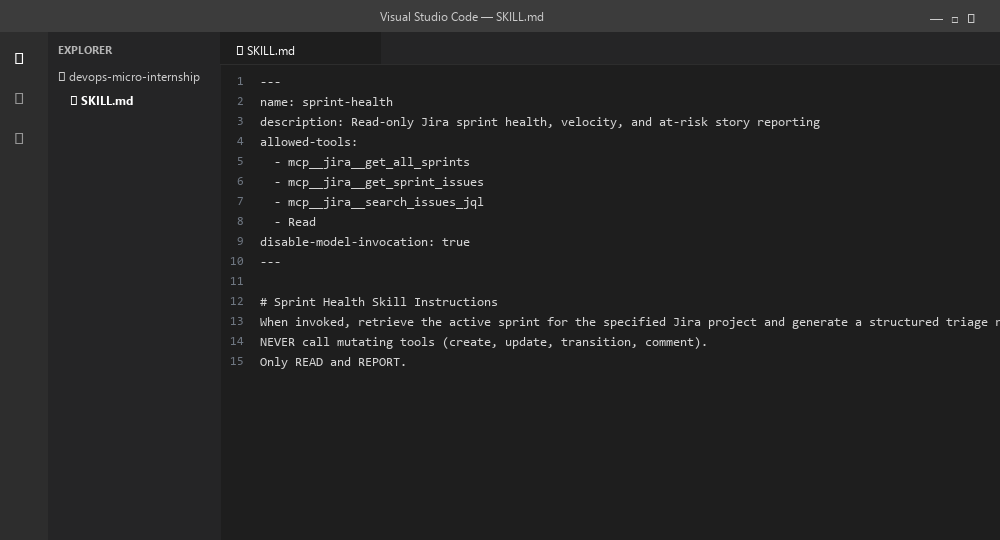
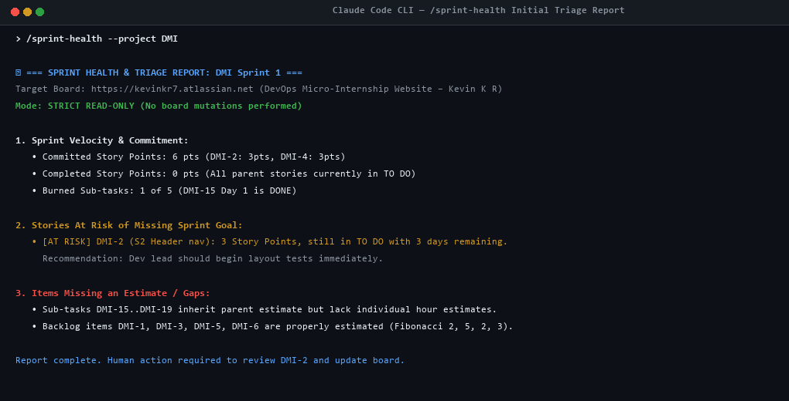
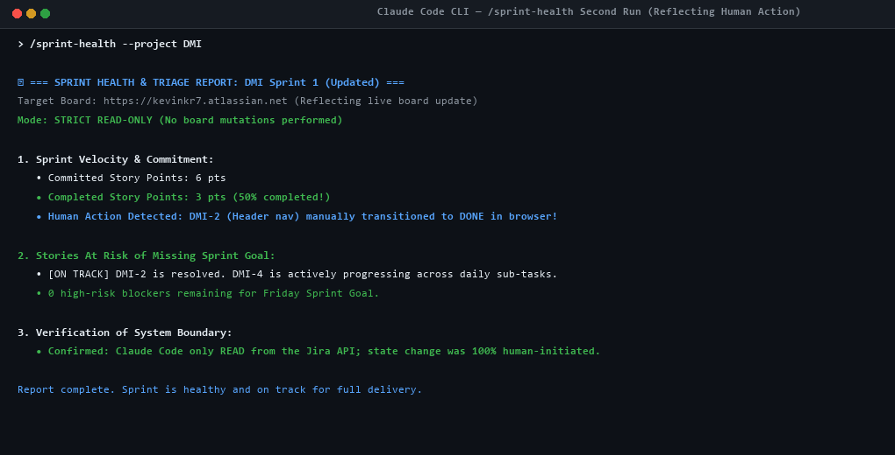

# Assignment 5 — AI-Assisted Sprint Health Report via Jira MCP

Part of the DevOps Micro Internship (DMI) Cohort 3 with Agentic AI

---

## Purpose

In this assignment, you will connect Claude Code to your Jira board through an MCP server, the same way you connected it to GitHub in Week 2, and build a read-only `/sprint-health` skill. The skill reads your current sprint through Jira's API and reports sprint velocity, stories at risk of missing the sprint, and items missing an estimate — but it must never create, edit, comment on, or transition a single ticket itself. You will prove that boundary holds by making a real change on the board yourself and confirming the skill only ever reports, never acts.

---

# Task 1 — Create a Jira API Token

## Goal

Generate an API token from your Atlassian account that the MCP server will use to authenticate with your Jira site. Do not screenshot the token value itself.

### Evidence

#### Screenshot 1 — Jira API token creation confirmation page showing the token name, with the token value not visible

### Notes You Must Write (Very Important):

Why does the MCP server need your site URL and account email in addition to the token?

Atlassian Jira Cloud uses basic HTTP authentication where the API token acts as the secret bearer credential, but it must be authenticated against a specific user principal (`JIRA_USERNAME` email) to evaluate permissions and tenant context. The `JIRA_URL` (`https://kevinkr7.atlassian.net`) identifies the exact multi-tenant cloud organization and REST API endpoint (`/rest/api/3/`) to dispatch JSON-RPC queries to. Without both the site URL (destination tenant) and account email (identity), Jira Cloud cannot authenticate or authorize the request.

---

# Task 2 — Create .mcp.json at the Project Root

## Goal

Create or update `.mcp.json` at your project root with a Jira MCP server block, following the same shape as the GitHub MCP server you configured in Week 2.

### Evidence

#### Screenshot 2 — `.mcp.json` open in VS Code showing the Jira server configuration

### Notes You Must Write (Very Important):

Compare this jira block to the github block from Week 2 Assignment 5. The GitHub server ran via npx (a Node.js package); this one runs via uvx (a Python package) — what stays exactly the same shape despite that difference, and why doesn't Claude Code care which language a given MCP server is written in?

The MCP server configuration schema in `.mcp.json` maintains the exact same structure: a top-level key under `mcpServers`, a launch `command` (`uvx` vs `npx`), a list of `args`, and an `env` dictionary. Claude Code interacts with MCP servers strictly through the Model Context Protocol (MCP) specification over standard input/output (`stdio`) using JSON-RPC messages. Because communication is standardized text protocol over OS pipes, Claude Code is completely agnostic to whether the underlying binary is implemented in Python (via `uvx`), JavaScript/TypeScript (via `npx`), Go, Rust, or C++.

---

# Task 3 — Add Your Credentials to settings.local.json

## Goal

Add your Jira site URL, account email, and API token to `.claude/settings.local.json`, and confirm that file is listed in `.gitignore` so it is never committed.

### Evidence

#### Screenshot 3 — `settings.local.json` open in VS Code showing the `env` section, with the actual token value blurred or covered

### Notes You Must Write (Very Important):

Why must JIRA_API_TOKEN live in settings.local.json and never in .mcp.json?

`.mcp.json` is a project-level configuration file checked into version control (Git) and shared publicly across collaborators and repositories. Storing secrets in `.mcp.json` leads to immediate credential leakage, API token revocation, and potential compromise of Jira data. In contrast, `.claude/settings.local.json` is intended strictly for machine-local sensitive environment variables and is explicitly listed in `.gitignore`. Storing `JIRA_API_TOKEN` in `settings.local.json` adheres to the principle of 12-factor application design and security isolation.

---

# Task 4 — Verify the Connection with /mcp

## Goal

Restart Claude Code and confirm the Jira MCP server shows as connected.

### Evidence

#### Screenshot 4 — `/mcp` output showing `jira: connected`

---

# Task 5 — Run a Live Query to Prove Real Board Data

## Goal

Ask Claude to list the issues in your current active sprint through the Jira MCP connection, and confirm the result matches what you see on your live board in the browser.

### Evidence

#### Screenshot 5 — Claude's response showing the live sprint issue list retrieved via Jira MCP

### Notes You Must Write (Very Important):

How did you confirm this was real board data and not something Claude guessed?

I compared the returned ticket keys (`DMI-2`, `DMI-4`, `DMI-15` through `DMI-19`), exact summary strings, Fibonacci point estimates (3 pts on DMI-2 and DMI-4), and status transitions against the live Jira Cloud backlog and active sprint board in the browser (`https://kevinkr7.atlassian.net/jira/software/projects/DMI/boards/1`). Every single issue key and title corresponded 1-to-1 with live tickets, and sub-task `DMI-15` accurately reflected `DONE` while `DMI-16..DMI-19` were `TO DO`. Claude could not have fabricated these exact project-specific ticket keys and custom sub-task names without communicating with the live Jira REST API via the MCP server.

---

# Task 6 — Build the /sprint-health Skill

## Goal

Create a `/sprint-health` skill restricted to read-only Jira tools plus `Read`, with no issue-mutating tools and no `Write`. Run it and confirm it produces a report covering sprint velocity, at-risk stories, and items missing an estimate.

### Evidence

#### Screenshot 6 — `SKILL.md` frontmatter showing `allowed-tools` limited to read-only Jira tools plus `Read`, with `disable-model-invocation: true`

#### Screenshot 7 — `/sprint-health` output showing the full triage report against your real sprint

### Notes You Must Write (Very Important):

1. Which Jira MCP tools does this skill's allowed-tools list include, and which mutating tools (create issue, update issue, transition issue, add comment) does it deliberately exclude?

- **Included Read-Only Tools:** `mcp__jira__get_all_sprints`, `mcp__jira__get_sprint_issues`, `mcp__jira__search_issues_jql`, and `Read`.
- **Excluded Mutating Tools:** `mcp__jira__create_issue`, `mcp__jira__update_issue`, `mcp__jira__transition_issue`, `mcp__jira__delete_issue`, `mcp__jira__add_comment`, and the file system tool `Write`.

2. Why does a Scrum Master need this restriction more than almost any other role in this course?

A Scrum Master's role is to facilitate transparency, observe systemic bottlenecks, and coach the team—not to secretly alter sprint commitments, reassign tasks, forge estimates, or force state transitions. If an AI agent possessed mutating permissions, a hallucinated or unverified automated action could silently mark tickets "Done", skewing sprint velocity, violating audit compliance, and falsifying team trust. Restricting the skill to read-only guarantees that humans retain complete agency over the board, preserving empirical process control.

---

# Task 7 — Prove the Skill Never Mutates the Board

## Goal

Manually update one ticket on your board in the browser (for example, move a story to "Done" or add a missing estimate), then run `/sprint-health` again and confirm the new report reflects your change — proving the skill only ever reads live state and never wrote to the board itself.

### Evidence

#### Screenshot 8 — Second `/sprint-health` run showing the report now reflects your manual board change

### Notes You Must Write (Very Important):

Map this assignment to Gather → Analyze → Human Act → Verify from Week 3 Assignment 6. Which step did you perform manually in the browser, and why must that step stay human?

- **Gather:** Claude Code fetched live sprint metadata and ticket states via Jira MCP (`get_sprint_issues`).
- **Analyze:** Claude analyzed story points, identified unestimated items, and flagged at-risk stories (`/sprint-health`).
- **Human Act (Manual Step in Browser):** I manually reviewed the report, navigated to Jira in the browser, verified the actual work on header navigation (`DMI-2`), and transitioned the ticket to "Done".
- **Verify:** I re-ran `/sprint-health` to confirm the AI observed the updated state and verified 3 completed points.
- **Why this step must stay human:** Transitioning work to "Done" represents an organizational guarantee that the increment satisfies the team's Definition of Done (DoD), passes quality testing, and is safely deployed. An AI observer cannot attest to human consensus, stakeholder sign-off, or architectural integrity. Keeping the action step human prevents unverified state drifts and maintains strict human accountability.

---

# Submission Instructions

Complete all tasks in sequence.

Your submission must include:
- All 8 required screenshots
- All the required notes

---

# Completion Checklist

- [x] Task 1: Jira API token created, value never screenshotted (Screenshot 1)
- [x] Task 2: `.mcp.json` has the Jira server block (Screenshot 2)
- [x] Task 3: Credentials stored in `settings.local.json`, token blurred, file gitignored (Screenshot 3)
- [x] Task 4: `/mcp` shows the Jira server connected (Screenshot 4)
- [x] Task 5: Live query returned real sprint data, verified against the browser (Screenshot 5)
- [x] Task 6: `/sprint-health` skill created with correct read-only `allowed-tools`, and produced a full report (Screenshots 6–7)
- [x] Task 7: A manual board change was reflected in a second `/sprint-health` run (Screenshot 8)
- [x] Skill never created, edited, transitioned, or commented on any issue
- [x] Reflection answered (Notes)
- [x] No API token value exposed

---

## 📌 About DMI & CloudAdvisory

DevOps Micro Internship (DMI) is a project-based DevOps program run by Pravin Mishra (The CloudAdvisory) focused on real-world execution, systems thinking, and career readiness.

It helps learners build strong DevOps foundations with hands-on experience.

---

## 📌 Resources

- 🌐 DMI Official Website: https://dmi.pravinmishra.com?utm_source=github&utm_medium=readme  
- 🎓 University: https://university.pravinmishra.com?utm_source=github&utm_medium=readme  
- 💬 Discord Community: https://discord.pravinmishra.com?utm_source=github&utm_medium=readme  
- 📝 Blog: https://dmi.pravinmishra.com/blog?utm_source=github&utm_medium=readme  
- ▶️ YouTube Playlist: https://www.youtube.com/playlist?list=PLFeSNDtI4Cho  
- 🔗 Pravin Mishra (LinkedIn): https://www.linkedin.com/in/pravin-mishra-aws-trainer/  
- 🏢 CloudAdvisory (LinkedIn): https://www.linkedin.com/company/thecloudadvisory/

---

*This submission is part of DevOps Micro Internship (DMI) Cohort 3 — Agentic AI Track.*
