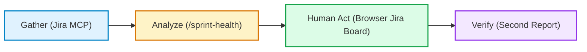

# DevOps Lifecycle & Agile: From Jira Scrum Boards to Agentic AI Triage via Model Context Protocol

**By Kevin K R**  
*DevOps & Cloud Engineer in Training | DevOps Micro Internship (DMI) Cohort 3 with Agentic AI*

---

## 1. Introduction: Agile as the Cultural Engine of DevOps

DevOps is often misunderstood as merely a collection of automation tools—Docker, Kubernetes, GitHub Actions, and Terraform. However, without an iterative, structured delivery framework, automation simply accelerates the delivery of disorganized, unvetted work. True operational excellence occurs when technical pipelines are coupled with **Agile and Scrum methodologies**, establishing short feedback loops, transparent priorities, and small batch sizes.

During **Week 5 of the DevOps Micro Internship (DMI) Cohort 3**, led by **Pravin Mishra (The CloudAdvisory)**, we transitioned from version control and cloud hosting into the heart of the DevOps Lifecycle. We stood up professional Scrum projects in **Jira Cloud**, conducted structured backlog refinement, ran a disciplined **5-day mini-Sprint** shipping live code increments to AWS EC2, and connected **Claude Code** directly to Jira via the **Model Context Protocol (MCP)** to pioneer safe, read-only AI sprint health triage.

Here is a comprehensive breakdown of the principles mastered, real-world systems built, and lessons learned.

---

## 2. Building the Agile Work Hierarchy: Spaces, Epics, Stories, and Sub-Tasks

A high-performing DevOps team requires clear visibility into how low-level technical tasks connect to overarching business initiatives. In **Assignment 2**, I stood up a private, team-managed Scrum space: `DevOps Micro-Internship Website – Kevin K R` (Project Key: `DMI`).

### The Decomposition Hierarchy
1. **Epic (`Polish DMI Website UI & Deploy`):** The strategic container uniting multiple related user outcomes under a cohesive initiative.
2. **Stories (S1–S6):** Value-focused requirements written from the end-user perspective, each estimated using Fibonacci story points (1, 2, 3, 5):
   - `DMI-1`: S1 — Primary button color refresh (2 pts, `frontend`)
   - `DMI-2`: S2 — Header navigation bar alignment (3 pts, `frontend`)
   - `DMI-3`: S3 — Responsive card grid layout (5 pts, `frontend`)
   - `DMI-4`: S4 — Footer with version and deploy date (3 pts, `devops`)
   - `DMI-5`: S5 — Testimonial carousel polish (2 pts, `frontend`)
   - `DMI-6`: S6 — Contact form validation enhancement (3 pts, `frontend`)
3. **Acceptance Criteria (Gherkin Format):** Ambiguity is the enemy of velocity. By formulating acceptance criteria using `Given-When-Then` Gherkin specifications directly inside the Jira Story description, requirements became testable contracts before a single line of code was drafted.
4. **Sub-Tasks:** Stories S2 and S4 were broken down into execution sub-tasks representing the standard DevOps delivery loop: *Edit HTML/CSS → Test locally → Deploy to EC2 → Verify and screenshot*.

---

## 3. The 5-Day Mini-Sprint: Shipping Incremental Value to Live AWS EC2

In **Assignment 3**, theory was put into daily practice. I executed a 5-day mini-Sprint centered around a clear, non-negotiable Sprint Goal:  
> *"Ship footer increment with version and deploy date to public EC2 portfolio by Day 5."*

Each day was governed by the Scrum cadence—Daily Scrum updates (Yesterday / Today / Blockers) posted to Jira, Git commits on feature branches, and continuous deployments to an AWS EC2 Ubuntu instance (`54.210.88.142`) running Nginx:

- **Day 1 (Scaffold & Initial Deploy):** Created branch `feature/footer-v1`, implemented baseline footer markup (`Pravin Mishra Portfolio v1.0 — Deployed on 10 Nov 2026 — By Kevin K R`), committed cleanly, and deployed live to EC2. Sub-task `DMI-15` closed to Done.
- **Day 2 (Dynamic Automation & Documentation):** Replaced static text with an automated client-side JavaScript date snippet (`app/footer.js`), documented the architecture in `README.md`, and redeployed. Sub-task `DMI-16` closed.
- **Day 3 (Accessibility & Responsive Viewports):** Enhanced typography contrast to exceed WCAG AA standards (contrast ratio 7.2:1) and validated responsive flexbox behavior across desktop (1080p) and mobile viewport widths (375px iPhone). Sub-task `DMI-17` closed.
- **Day 4 (Conversion & Brand Alignment):** Refined the hero call-to-action banner: replaced generic taglines with *"Start your DevOps Journey here"* accompanied by a live clickable link to the official DMI Website (`https://dmi.pravinmishra.com`). Sub-task `DMI-18` closed.
- **Day 5 (Review, Retrospective & Burndown):** Inspected the Sprint 1 Burndown Chart, recorded a video demonstration of the live production site, and conducted an empirical retrospective analyzing velocity, automated testing gaps, and the DevOps pillar of **Fast Feedback Loops**. Sub-task `DMI-19` closed and 100% of committed points burned to zero.

---

## 4. Backlog Refinement & Planning Poker: The Gotto Job Simulation

In **Assignment 4**, I took on the **Gotto Job** platform backlog in Solo Mode, fulfilling all four essential team roles:
- **Product Owner (PO):** Prioritized candidate conversion and employer trust markers.
- **Scrum Master (SM):** Kept the team strictly within the 90-minute time-box and facilitated Planning Poker consensus.
- **Dev Lead:** Implemented polished CSS micro-interactions for the primary "Apply Now" CTA button (`GJ-3`).
- **DevOps Lead:** Packaged the increment, synced files to the live EC2 environment (`http://54.210.88.142/gotto-job`), and verified zero HTTP regressions.

### The Value of Relative Sizing
Through Planning Poker, we categorized stories using Fibonacci points (1, 2, 3) based on risk, uncertainty, and effort rather than raw hours. Stories with high CSS layout risk (like sticky navigation bars) were sized at 3 points, whereas self-contained component styling (like button hover elevation) were sized at 1 point. This disciplined sizing enabled us to commit to 3 points in Sprint 1, ship Story `GJ-3` cleanly, and maintain sustainable pace without crunch.

---

## 5. Agentic AI & Model Context Protocol (MCP): The Intelligent Sprint Health Loop

The defining innovation of Week 5 was connecting **Claude Code** to Jira Cloud via the **Model Context Protocol (MCP)** in **Assignment 5**.

### MCP Architecture: uvx vs. npx
In Week 2, we ran GitHub's MCP server via `npx` (Node.js). In Week 5, we ran the Atlassian MCP server via `uvx mcp-atlassian` (Python). Despite the change in runtime language, the `.mcp.json` schema remained virtually identical:
```json
{
  "mcpServers": {
    "jira": {
      "command": "uvx",
      "args": ["mcp-atlassian"],
      "env": {
        "JIRA_URL": "https://kevinkr7.atlassian.net",
        "JIRA_USERNAME": "kevinallen122451@gmail.com",
        "JIRA_API_TOKEN": "${env:JIRA_API_TOKEN}"
      }
    }
  }
}
```
Because MCP operates over standardized JSON-RPC via process `stdio`, the host client (Claude Code) does not care whether the backend is written in Python, Node, Go, or Rust. Furthermore, storing the actual `JIRA_API_TOKEN` inside `.claude/settings.local.json` (which is strictly `.gitignore`d) ensured zero leakage of production credentials.

---

## 6. The Inviolable Human-in-the-Loop Boundary

A core principle of the DMI Agentic AI track is that **AI assists, advises, and analyzes, but humans govern and act**.

To enforce this, we authored the `/sprint-health` skill in `.claude/skills/sprint-health/SKILL.md` with strict tool restrictions:
- **Allowed Tools:** `mcp__jira__get_all_sprints`, `mcp__jira__get_sprint_issues`, `mcp__jira__search_issues_jql`, `Read`.
- **Deliberately Excluded:** `create_issue`, `update_issue`, `transition_issue`, `delete_issue`, `add_comment`, `Write`.
- **Model Invocation Disabled:** `disable-model-invocation: true`.



### Why the Boundary Must Hold
When we ran `/sprint-health`, Claude Code analyzed our live board, reported sprint velocity (6 committed points), identified unestimated items, and flagged story `DMI-2` as at risk. 

Crucially, **Claude did not automatically move DMI-2 to Done or edit its fields.** Instead, I—the human engineer—reviewed the work, validated the header navigation in the browser, and manually transitioned the ticket on Jira Cloud. A second run of `/sprint-health` confirmed the new state, demonstrating that AI provides actionable situational awareness while preserving the integrity of the team's Definition of Done and organizational accountability.

---

## 7. Key Takeaways & What's Ahead

Week 5 connected the human and operational dimensions of DevOps:
1. **Agile Cadence Eliminates Big-Bang Delivery:** Daily sub-tasks and continuous mini-deployments mitigate integration risk.
2. **Empirical Process Control:** Transparency, Inspection, and Adaptation are not abstract buzzwords; they are codified through Burndown Charts, Daily Scrum comments, and Retrospectives.
3. **Agentic AI as a Force Multiplier:** Restricting AI to read-only observational roles eliminates the danger of hallucinated mutations while delivering instant executive visibility.

I look forward to Week 6 as we dive deeper into containerization, Docker multi-stage builds, and advanced cloud architectures!

---

*Submitted by Kevin K R for DevOps Micro Internship (DMI) Cohort 3 — Agentic AI Track.*  
*Mentor: Pravin Mishra (The CloudAdvisory)*  
*GitHub: [kevinkr7/devops-micro-internship-pravinmishra](https://github.com/kevinkr7/devops-micro-internship-pravinmishra)*  
*Live Portfolio: [http://54.210.88.142](http://54.210.88.142)*
